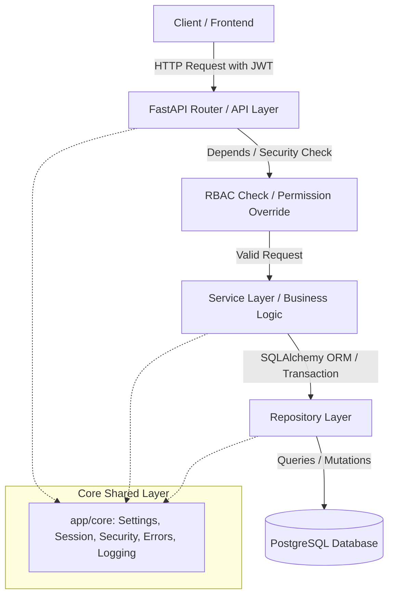

# System Architecture — SmartLMS

This document describes the software architecture, folder structure, data flow, and architectural principles of the **SmartLMS** project.

---

## 1. Architectural Style (Modular Monolith)

SmartLMS is designed as a **Modular Monolith** with a **Layered Architecture** inside each module.

- **Modular Monolith:** The codebase is split into independent packages by business domain (located in `app/modules/`). This isolates business logic, makes it easier to maintain, and allows modules to be extracted into microservices in the future.
- **Layered Architecture:** Each module is divided into separate layers with distinct responsibilities to ensure the **Separation of Concerns (SoC)** principle.

---

## 2. System Architecture & Data Flow

The following diagram illustrates the flow of an HTTP request through the system:



### Flow Steps:
1. **Client** sends an HTTP request with a JWT token.
2. **FastAPI Router** intercepts the request and verifies credentials and permissions (RBAC) via FastAPI Dependencies (`Depends`).
3. **Service** executes the core business logic and manages transactions (Commit / Rollback).
4. **Repository** performs DB operations using SQLAlchemy.
5. **Database** (PostgreSQL) processes the SQL commands.

---

## 3. Directory Structure

The repository is structured as follows:

```text
.
├── alembic/                       # Database migrations generated by Alembic
├── docs/                          # Project specifications, SRS, and architecture docs
│   ├── v_1/
│   │   ├── specs/                 # Feature specifications
│   │   └── sprints/               # Sprint planning documents
├── app/                           # FastAPI application source code
│   ├── core/                      # Shared core modules (cross-cutting concerns)
│   │   ├── config.py              # Application settings (loaded from env)
│   │   ├── security.py            # JWT authentication and RBAC checks
│   │   ├── errors.py              # Global exception handlers and error codes
│   │   └── database.py            # SQLAlchemy engine and session lifecycle
│   ├── modules/                   # Independent business packages (modules)
│   │   ├── auth/                  # Authentication & RBAC module
│   │   │   ├── router.py          # API endpoints for authentication
│   │   │   ├── service.py         # Business logic for auth
│   │   │   ├── repository.py      # Database operations for users/roles
│   │   │   ├── schemas.py         # Pydantic schemas for request/response validation
│   │   │   └── models.py          # SQLAlchemy models for auth tables
│   │   ├── tracking/              # Learning behavior tracking module
│   │   └── ...
│   ├── main.py                    # FastAPI app initialization and router registration
└── tests/                         # Unit tests and integration tests
```

---

## 4. Layer Responsibilities

To maintain clean code, each layer must adhere to its specific responsibility:

### A. API Layer (Routers — `router.py`)
- **Responsibility:** Handles HTTP requests, validates input using Pydantic models, checks user permissions (e.g., `require_perm("EXERCISE_CREATE")`), and calls the Service layer.
- **Rule:** Never write business logic or execute raw database queries in this layer.

### B. Business Logic Layer (Services — `service.py`)
- **Responsibility:** Handles core business logic, validations, and manages database transactions (Commit/Rollback).
- **Rule:** Keep it protocol-agnostic (it should not know about HTTP requests or FastAPI directly).

### C. Data Access Layer (Repositories — `repository.py`)
- **Responsibility:** Performs CRUD (Create, Read, Update, Delete) operations and complex queries on PostgreSQL via SQLAlchemy ORM.
- **Rule:** Do not write business logic here; keep it focused entirely on database interactions.

---

## 5. Architectural Standards

### A. Role-Based Access Control (RBAC)
- Fine-grained, permission-based access control.
- Permissions can be customized or overridden per user (`user_permissions`).
- If conflict arises, `deny` overrides `allow` (fail-closed model).

### B. Error Handling & Logging
- **Error Format:** Standardized JSON error response with custom application error codes.
- **Logging Rules:** Clean text logs only. Do **NOT** use icons or emojis in log messages.

### C. Configuration Security
- Never read `.env` files directly inside modules. Use the unified configuration class at `app/core/config.py`.
