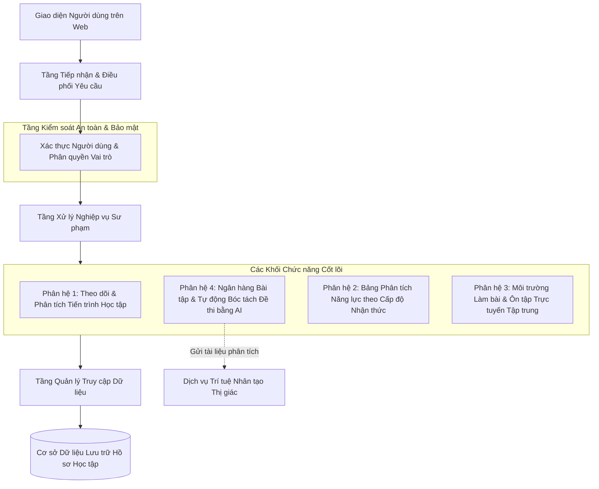
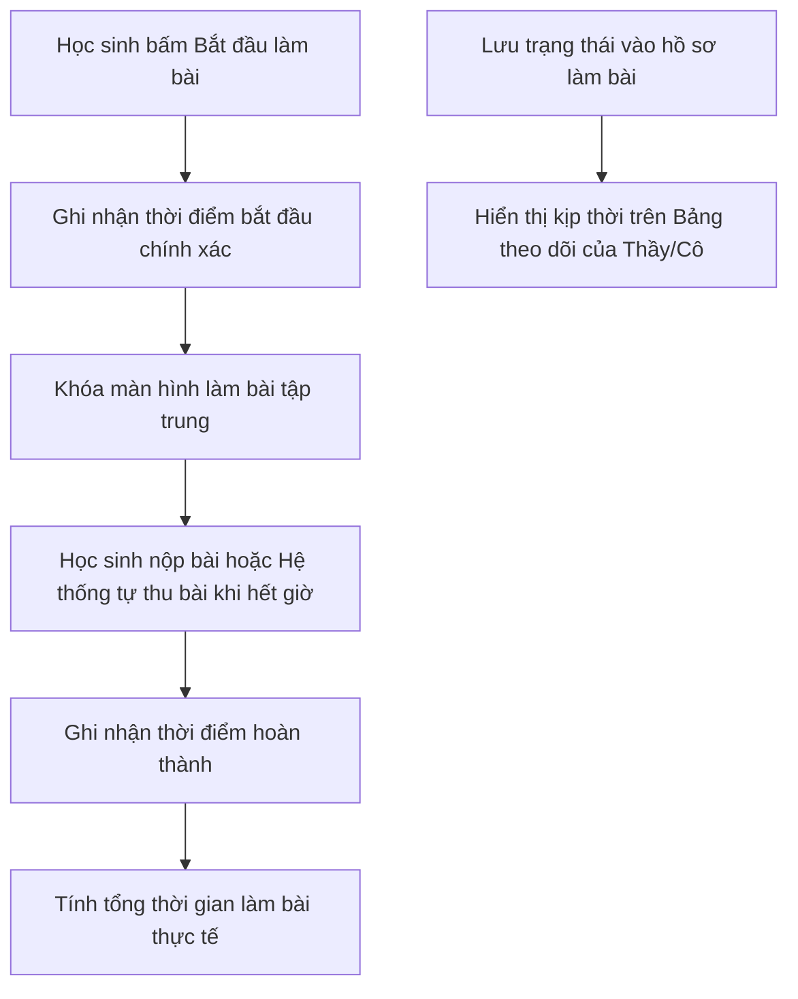
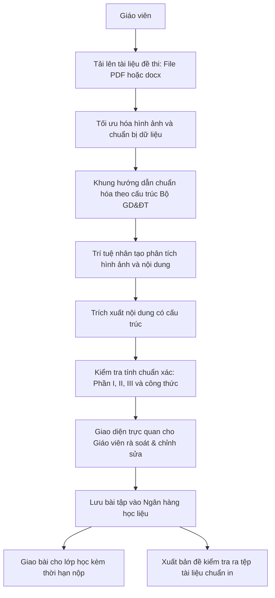

<!--
File Name: bao_cao_nghien_cuu_khkt_smartlms.md
Description: Báo cáo nghiên cứu khoa học kỹ thuật (KHKT) về Hệ thống Quản lý bài tập và Ôn luyện trực tuyến kết hợp Phân tích tiến trình học tập và Ứng dụng Trí tuệ nhân tạo dành cho Giáo viên và Học sinh (SmartLMS)
Created At: 2026-10-29
Created By: Tam Khang
Updated At: 2026-11-01
Updated By: Tam Khang
-->

# DỰ ÁN NGHIÊN CỨU KHOA HỌC KỸ THUẬT: HỆ THỐNG QUẢN LÝ BÀI TẬP VÀ ÔN LUYỆN TRỰC TUYẾN KẾT HỢP PHÂN TÍCH TIẾN TRÌNH HỌC TẬP VÀ ỨNG DỤNG TRÍ TUỆ NHÂN TẠO DÀNH CHO GIÁO VIÊN VÀ HỌC SINH (SMARTLMS)

* **Lĩnh vực dự thi:** 8. Công nghệ thông tin (Phần mềm hệ thống / Ứng dụng Giáo dục thông minh EdTech)
* **Đối tượng ứng dụng:** Học sinh, Giáo viên bộ môn, Giáo viên chủ nhiệm  trường Trung học phổ thông (THPT)

---

## TÓM TẮT DỰ ÁN (EXECUTIVE ABSTRACT)

Trước yêu cầu đổi mới căn bản phương pháp dạy học và kiểm tra đánh giá theo Chương trình Giáo dục phổ thông (GDPT) 2018, nhu cầu về một môi trường học tập trực tuyến chuẩn hóa để học sinh có thể chủ động ôn tập, rèn luyện kiến thức và tự đánh giá năng lực của bản thân ngày càng trở nên cấp thiết. Bên cạnh đó, thầy cô giáo cũng gặp nhiều khó khăn khi phải dành nhiều thời gian biên soạn lại các bộ đề kiểm tra đa dạng theo định dạng cấu trúc 3 phần mới của Bộ Giáo dục và Đào tạo cho nhiều môn học khác nhau, cũng như khó nắm bắt được mức độ tự giác và tiến trình làm bài thực tế của học sinh ngoài giờ lên lớp.

Dự án **SmartLMS** được nghiên cứu và xây dựng nhằm cung cấp một nền tảng trực tuyến toàn diện, hướng tới các mục tiêu cốt lõi:
1. Xây dựng môi trường trực tuyến thân thiện, tập trung để học sinh có thể ôn tập, rèn luyện kiến thức thường xuyên, làm quen với cấu trúc đề kiểm tra 3 phần mới (Trắc nghiệm nhiều lựa chọn, Đúng/Sai, Trả lời ngắn) áp dụng cho các môn học.
2. Ứng dụng trí tuệ nhân tạo hỗ trợ giáo viên tự động nhận diện và bóc tách tài liệu đề thi sẵn có (dưới dạng tệp PDF, docx ) thành đề kiểm tra trực tuyến chuẩn hóa cho đại đa số các bộ môn, giúp tiết kiệm công sức nhập liệu.
3. Tự động ghi nhận và phân tích tiến trình làm bài thực tế của học sinh (thời điểm bắt đầu, thời điểm hoàn thành và thời lượng làm bài), kịp thời phát hiện các dấu hiệu làm bài vội vã, đối phó để nhắc nhở các em rèn luyện tính tự giác.
4. Trực quan hóa kết quả học tập qua biểu đồ năng lực đa chiều theo các cấp độ nhận thức (Nhận biết, Thông hiểu, Vận dụng), giúp học sinh nhận biết rõ điểm mạnh và phần kiến thức cần củng cố, đồng thời cung cấp góc nhìn sư phạm phù hợp cho cả giáo viên bộ môn lẫn giáo viên chủ nhiệm.

---

## MỤC LỤC

- [MỞ ĐẦU](#mở-đầu)
  - [1. Tính cấp thiết của đề tài](#1-tính-cấp-thiết-của-đề-tài)
  - [2. Lý do chọn đề tài](#2-lý-do-chọn-đề-tài)
  - [3. Mục tiêu và nhiệm vụ nghiên cứu](#3-mục-tiêu-và-nhiệm-vụ-nghiên-cứu)
  - [4. Ý nghĩa khoa học và thực tiễn của đề tài](#4-ý-nghĩa-khoa-học-và-thực-tiễn-của-đề-tài)
  - [5. Câu hỏi nghiên cứu và Giả thuyết khoa học](#5-câu-hỏi-nghiên-cứu-và-giả-thuyết-khoa-học)
- [Chương 1: CƠ SỞ KHOA HỌC VÀ TỔNG QUAN VỀ GIẢI PHÁP](#chương-1-cơ-sở-khoa-học-và-tổng-quan-về-giải-pháp)
  - [1.1. Cơ sở lý luận về phân tích tiến trình học tập](#11-cơ-sở-lý-luận-về-phân-tích-tiến-trình-học-tập)
  - [1.2. Chuẩn đánh giá năng lực và Định dạng cấu trúc đề thi mới của Bộ GD&ĐT](#12-chuẩn-đánh-giá-năng-lực-và-định-dạng-cấu-trúc-đề-thi-mới-của-bộ-gdđt)
  - [1.3. Cơ sở công nghệ về nhận diện tài liệu học liệu và trí tuệ nhân tạo thị giác](#13-cơ-sở-công-nghệ-về-nhận-diện-tài-liệu-học-liệu-và-trí-tuệ-nhân-tạo-thị-giác)
  - [1.4. Đánh giá bối cảnh công nghệ và Định hướng phát triển của hệ thống](#14-đánh-giá-bối-cảnh-công-nghệ-và-định-hướng-phát-triển-của-hệ-thống)
  - [1.5. Khoảng trống nghiên cứu và Định hướng giải pháp của đề tài](#15-khoảng-trống-nghiên-cứu-và-định-hướng-giải-pháp-của-đề-tài)
- [Chương 2: THIẾT KẾ GIẢI PHÁP, KIẾN TRÚC HỆ THỐNG VÀ THỰC THI KỸ THUẬT](#chương-2-thiết-kế-giải-pháp-kiến-trúc-hệ-thống-và-thực-thi-kỹ-thuật)
  - [2.1. Mô hình tổng thể và các tầng chức năng của hệ thống](#21-mô-hình-tổng-thể-và-các-tầng-chức-năng-của-hệ-thống)
  - [2.2. Phân hệ 1: Theo dõi và Phân tích tiến trình làm bài của học sinh](#22-phân-hệ-1-theo-dõi-và-phân-tích-tiến-trình-làm-bài-của-học-sinh)
  - [2.3. Phân hệ 2: Ngân hàng Bài tập và Tự động bóc tách đề thi bằng Trí tuệ nhân tạo](#23-phân-hệ-2-ngân-hàng-bài-tập-và-tự-động-bóc-tách-đề-thi-bằng-trí-tuệ-nhân-tạo)
  - [2.4. Phân hệ 3: Bảng phân tích năng lực theo cấp độ nhận thức hỗ trợ sư phạm](#24-phân-hệ-3-bảng-phân-tích-năng-lực-theo-cấp-độ-nhận-thức-hỗ-trợ-sư-phạm)
  - [2.5. Phân hệ 4: Môi trường làm bài và ôn tập trực tuyến tập trung](#25-phân-hệ-4-môi-trường-làm-bài-và-ôn-tập-trực-tuyến-tập-trung)
- [KẾT LUẬN VÀ HƯỚNG PHÁT TRIỂN](#kết-luận-và-hướng-phát-triển)
- [TÀI LIỆU THAM KHẢO](#tài-liệu-tham-khảo)
- [PHỤ LỤC](#phụ-lục)
  - [Phụ lục 1: Phiếu khai báo sử dụng công nghệ số và trí tuệ nhân tạo (Mẫu Phụ lục VI)](#phụ-lục-1-phiếu-khai-báo-sử-dụng-công-nghệ-số-và-trí-tuệ-nhân-tạo-mẫu-phụ-lục-vi)
  - [Phụ lục 2: Phiếu khảo sát ý kiến giáo viên và học sinh](#phụ-lục-2-phiếu-khảo-sát-ý-kiến-giáo-viên-và-học-sinh)
  - [Phụ lục 3: Mô hình cấu trúc dữ liệu và các luồng chức năng chính của hệ thống](#phụ-lục-3-mô-hình-cấu-trúc-dữ-liệu-và-các-luồng-chức-năng-chính-của-hệ-thống)

---

## MỞ ĐẦU

### 1. Tính cấp thiết của đề tài
Nghị quyết số 29-NQ/TW của Ban Chấp hành Trung ương Đảng về đổi mới căn bản, toàn diện giáo dục và đào tạo đã nhấn mạnh yêu cầu chuyển từ việc trang bị kiến thức đơn thuần sang phát triển toàn diện phẩm chất và năng lực người học. Đặc biệt, theo Chương trình GDPT 2018 và cấu trúc đề thi tốt nghiệp THPT mới do Bộ GD&ĐT ban hành (Quyết định số 764/QĐ-BGDĐT), đề thi của hầu hết các môn học (Toán, Vật lí, Hóa học, Sinh học, Lịch sử, Địa lí,...) đã có sự thay đổi mang tính bước ngoặt sang **cấu trúc 3 phần chuyên biệt**:
- **Phần I:** Câu hỏi trắc nghiệm nhiều phương án lựa chọn.
- **Phần II:** Câu hỏi trắc nghiệm Đúng/Sai (mỗi câu gồm 4 ý $a, b, c, d$).
- **Phần III:** Câu hỏi trắc nghiệm dạng trả lời ngắn (yêu cầu học sinh tính toán hoặc tổng hợp để điền đáp số).

Sự thay đổi này đặt ra những yêu cầu thực tiễn rất lớn đối với cả học sinh và giáo viên trong nhà trường:
1. **Học sinh cần một môi trường chuẩn hóa để ôn tập và rèn luyện kiến thức:** Để đáp ứng được định dạng đề thi mới, học sinh không thể chỉ học lý thuyết một chiều mà cần một không gian trực tuyến thuận lợi, an toàn để tự luyện tập thường xuyên, làm quen với các dạng câu hỏi suy luận và tự đánh giá được năng lực của mình theo từng cấp độ nhận thức.
2. **Khối lượng công việc biên soạn tài liệu cho các môn học tăng cao:** Việc nhập thủ công đề kiểm tra chứa các công thức khoa học, hình vẽ minh họa, biểu đồ và văn bản dài chiếm rất nhiều thời gian của giáo viên ở nhiều bộ môn.
3. **Khó nắm bắt tiến trình và thái độ tự học tại nhà:** Khi giao bài tập về nhà trên các công cụ biểu mẫu trực tuyến thông thường, giáo viên thường chỉ nhận được kết quả điểm số cuối cùng mà không nắm được học sinh thực sự dành bao nhiêu thời gian làm bài, có tập trung hay làm bài vội vã đối phó.
4. **Cần công cụ trực quan hóa năng lực theo cấp độ nhận thức:** Điểm số đơn thuần không phản ánh rõ học sinh đang vững hay yếu ở cấp độ nào (Nhận biết, Thông hiểu, hay Vận dụng) để thầy cô có giải pháp bồi dưỡng và phụ đạo trúng đích.

Do đó, việc nghiên cứu và xây dựng một **Hệ thống Quản lý Bài tập và Ôn luyện trực tuyến kết hợp Phân tích Tiến trình Học tập và Ứng dụng Trí tuệ Nhân tạo (SmartLMS)** là yêu cầu thực tiễn cấp bách nhằm tạo dựng môi trường rèn luyện kiến thức hiệu quả cho học sinh và hỗ trợ đắc lực cho công tác giảng dạy của thầy cô giáo.

### 2. Lý do chọn đề tài
Trong kỷ nguyên số, Internet và Trí tuệ nhân tạo (AI) đang phát triển vô cùng mạnh mẽ và dần trở thành một phần không thể thiếu trong đời sống xã hội. Tuy nhiên, trong môi trường học đường, việc ứng dụng công nghệ số và trí tuệ nhân tạo vẫn còn nhiều thách thức: thầy cô chưa có nhiều công cụ thông minh chuyên biệt để hỗ trợ giảm tải công việc chuyên môn; trong khi học sinh tiếp cận Internet hàng ngày nhưng thường thiếu một môi trường trực tuyến định hướng giáo dục lành mạnh để tự giác học tập và củng cố kiến thức, dẫn đến nguy cơ sử dụng Internet vào các mục đích thiếu hữu ích hoặc phụ thuộc một cách thụ động vào công nghệ.

Xuất phát từ mong muốn đẩy mạnh chuyển đổi số thiết thực trong giáo dục, tác giả mong muốn xây dựng một giải pháp công nghệ toàn diện nhằm:
- Hỗ trợ giáo viên và học sinh tiếp cận và sử dụng Internet cùng Trí tuệ nhân tạo một cách phù hợp, thông minh và có trách nhiệm hơn.
- Cung cấp cho học sinh một không gian ôn tập, rèn luyện kiến thức chuẩn mực, giúp các em chủ động theo dõi sự tiến bộ của bản thân và hình thành thói quen tự học có kế hoạch.
- Ứng dụng trí tuệ nhân tạo như một "trợ thủ đắc lực" giúp thầy cô giải phóng sức lao động ở khâu số hóa đề bài và theo dõi sát sao tiến trình học tập của học sinh.

Chính vì những lý do trên, tác giả đã quyết định lựa chọn và triển khai đề tài **SmartLMS**.

### 3. Mục tiêu và nhiệm vụ nghiên cứu
* **Mục tiêu tổng quát:** Xây dựng một hệ thống học tập và ôn luyện trực tuyến chuyên biệt, hỗ trợ học sinh có môi trường tự rèn luyện và củng cố kiến thức thường xuyên; đồng thời hỗ trợ thầy cô giáo số hóa đề thi tự động bằng trí tuệ nhân tạo cho đa số các môn học, theo dõi tiến trình làm bài và trực quan hóa năng lực học sinh theo các cấp độ nhận thức để hỗ trợ nâng cao chất lượng dạy và học.
* **Nhiệm vụ nghiên cứu cụ thể:**
  1. Xây dựng môi trường làm bài và ôn tập trực tuyến tập trung, tích hợp bàn phím chuyên dụng hỗ trợ các dạng câu hỏi.
  2. Nghiên cứu mô hình trí tuệ nhân tạo nhận diện tài liệu để tự động bóc tách các tệp đề thi (PDF, docx) sang định dạng cấu trúc 3 phần mới cho đa dạng các bộ môn.
  3. Xây dựng thuật toán ghi nhận và phân tích tiến trình làm bài (thời điểm bắt đầu, thời điểm hoàn thành, tổng thời lượng thực tế).
  4. Thiết kế giao diện trực quan hóa năng lực học sinh theo các cấp độ nhận thức (Nhận biết, Thông hiểu, Vận dụng) thông qua biểu đồ năng lực đa chiều, phục vụ thiết thực cho giáo 

### 4. Ý nghĩa khoa học và thực tiễn của đề tài
* **Ý nghĩa khoa học:** Đề tài ứng dụng phương pháp phân tích dữ liệu giáo dục kết hợp với công nghệ trí tuệ nhân tạo nhận diện tài liệu để chuyển đổi tài liệu học tập thành dữ liệu có cấu trúc phục vụ quản lý và giảng dạy.
* **Ý nghĩa thực tiễn:** 
  - Tạo ra môi trường học tập và ôn luyện trực tuyến bổ ích, giúp học sinh chủ động rèn luyện kiến thức và tự đánh giá năng lực theo chuẩn mới.
  - Giúp giáo viên các bộ môn tiết kiệm phần lớn thời gian biên soạn bài tập và đề kiểm tra.
  - Giúp giáo viên có thêm thông tin thực chất về thái độ và tiến trình làm bài của học sinh để có biện pháp giáo dục phù hợp.

### 5. Câu hỏi nghiên cứu và Giả thuyết khoa học
* **Câu hỏi nghiên cứu:**
  1. Việc xây dựng một nền tảng trực tuyến chuyên biệt có giúp học sinh có thêm môi trường thuận lợi để tự ôn tập, rèn luyện kiến thức và làm quen với cấu trúc đề thi mới hay không?
  2. Ứng dụng trí tuệ nhân tạo có thể hỗ trợ bóc tách đề thi và chuẩn hóa câu hỏi, công thức từ các tệp tài liệu số (PDF, docx) và ảnh chụp của các môn học đạt hiệu quả như thế nào?
  3. Việc theo dõi thời lượng làm bài thực tế có tác động như thế nào đến thói quen tự giác của học sinh?
  4. Biểu đồ năng lực đa chiều theo các cấp độ nhận thức có thực sự giúp giáo viên và học sinh nhận biết rõ điểm mạnh, điểm yếu để điều chỉnh việc dạy và học hay không?
* **Giả thuyết khoa học:**
  - *Giả thuyết 1:* Nền tảng học tập trực tuyến tập trung sẽ tạo điều kiện thuận lợi để học sinh chủ động ôn tập và củng cố kiến thức theo đúng định dạng kiểm tra đánh giá mới.
  - *Giả thuyết 2:* Mô hình trí tuệ nhân tạo nhận diện tài liệu kết hợp với các hướng dẫn chuẩn hóa có thể hỗ trợ số hóa chính xác phần lớn các câu hỏi và nội dung từ các định dạng tài liệu số phổ biến của các môn học.
  - *Giả thuyết 3:* Việc ghi nhận thời lượng thực tế và nhắc nhở các trường hợp làm bài qua loa sẽ giúp nâng cao tính tự giác và tinh thần trách nhiệm của học sinh khi tự học.
  - *Giả thuyết 4:* Biểu đồ năng lực phân loại theo cấp độ nhận thức (Nhận biết, Thông hiểu, Vận dụng) cung cấp thông tin định hướng học tập rõ ràng hơn nhiều so với điểm số đơn thuần.

---

## Chương 1: CƠ SỞ KHOA HỌC VÀ TỔNG QUAN VỀ GIẢI PHÁP

### 1.1. Cơ sở lý luận về phân tích tiến trình học tập
Phân tích tiến trình học tập (*Learning Analytics*) được Hiệp hội Nghiên cứu Phân tích Học tập Quốc tế (SOLAR) định nghĩa là: *"Việc đo lường, thu thập, phân tích và báo cáo dữ liệu về người học cùng bối cảnh học tập của họ, nhằm mục đích thấu hiểu và tối ưu hóa việc học cũng như môi trường diễn ra việc học đó"*.

Trong môi trường giáo dục trực tuyến truyền thống, dữ liệu thu thập thường dừng lại ở mức "kết quả tĩnh" (như điểm số hoặc số câu đúng/sai). Tuy nhiên, các nghiên cứu giáo dục hiện đại chỉ ra rằng **dữ liệu tiến trình học tập** mới là nhân tố phản ánh chân thực mức độ gắn kết và thái độ học tập của học sinh. Cụ thể:
- **Thời điểm bắt đầu làm bài:** Phản ánh tính chủ động và mức độ ưu tiên nhiệm vụ học tập của học sinh.
- **Thời điểm nộp bài:** So sánh với thời hạn chót nộp bài để xác định thói quen sắp xếp thời gian làm bài của học sinh.
- **Tổng thời gian thực tế làm bài:** Nếu một đề kiểm tra cần khoảng 45 phút mà học sinh nộp bài chỉ sau vài phút nhưng đạt điểm cao bất thường, đây là dấu hiệu rõ ràng của việc làm bài đối phó hoặc sao chép đáp án.

### 1.2. Chuẩn đánh giá năng lực và Định dạng cấu trúc đề thi mới của Bộ GD&ĐT
Theo Quyết định số 764/QĐ-BGDĐT của Bộ GD&ĐT quy định cấu trúc định dạng đề thi Kỳ thi tốt nghiệp THPT từ năm 2025, cấu trúc đề thi của đại đa số các bộ môn được chuẩn hóa theo 3 phần:
* **Cấu trúc 3 phần chuẩn hóa:**
  - **Phần I:** Câu hỏi trắc nghiệm nhiều phương án lựa chọn.
  - **Phần II:** Câu hỏi trắc nghiệm Đúng/Sai với các ý $a, b, c, d$.
  - **Phần III:** Câu hỏi trắc nghiệm dạng trả lời ngắn, yêu cầu học sinh tính toán hoặc tổng hợp để điền đáp số.
* **Đánh giá theo các cấp độ nhận thức:** Đề thi được thiết kế phân hóa rõ ràng theo 3 cấp độ nhận thức cốt lõi:
  - **Cấp độ Nhận biết:** Học sinh nhớ lại và nhận diện các kiến thức, khái niệm, công thức cơ bản.
  - **Cấp độ Thông hiểu:** Học sinh hiểu bản chất kiến thức, có khả năng giải thích, so sánh và phân tích cơ bản.
  - **Cấp độ Vận dụng:** Học sinh áp dụng kiến thức để giải quyết các tình huống, bài toán và vấn đề thực tiễn.
* **Quy chuẩn hiển thị nội dung học liệu:** Các công thức khoa học, phương trình, đồ thị, sơ đồ và ký hiệu chuyên ngành của các môn học cần được chuẩn hóa để hiển thị sắc nét, chính xác trên mọi màn hình máy tính và thiết bị di động.

### 1.3. Cơ sở công nghệ về nhận diện tài liệu học liệu và trí tuệ nhân tạo thị giác
Trong thực tế giảng dạy, giáo viên thường lưu trữ tài liệu đề thi dưới nhiều định dạng khác nhau: tài liệu soạn thảo văn bản (Word/docx), tệp tài liệu số (PDF). Các công cụ nhận diện truyền thống trước đây chỉ xử lý được văn bản đơn giản và thường làm sai lệch cấu trúc bảng biểu, công thức hoặc hình vẽ.

Sự phát triển của các mô hình trí tuệ nhân tạo thế hệ mới sở hữu khả năng hiểu ngữ cảnh không gian và cấu trúc văn bản vượt trội, cho phép hệ thống đọc hiểu tài liệu, tự động phân tách đề bài thành các phần câu hỏi rõ ràng và chuẩn hóa định dạng hiển thị cho các môn học một cách chính xác.

### 1.4. Đánh giá bối cảnh công nghệ và Định hướng phát triển của hệ thống
Hệ thống SmartLMS được định hướng phát triển tập trung vào việc đáp ứng toàn diện các nhu cầu thực tế của nhà trường phổ thông hiện nay:
1. **Môi trường rèn luyện kiến thức chuẩn mực:** Cung cấp cho học sinh không gian làm bài trực quan, giao diện tập trung giúp các em thoải mái ôn tập và làm quen với phương thức thi cử hiện tại.
2. **Tương thích toàn diện với cấu trúc đề mới cho đa số các môn học:** Thiết kế giao diện và thuật toán xử lý phù hợp cho cấu trúc 3 phần (Trắc nghiệm, Đúng/Sai, Trả lời ngắn) áp dụng đồng bộ cho các môn khoa học tự nhiên lẫn khoa học xã hội.
3. **Ứng dụng Trí tuệ Nhân tạo thông minh:** Sử dụng AI như công cụ hỗ trợ giáo viên bóc tách nhanh chóng các tài liệu đề thi sẵn có (PDF, docx), giảm thiểu tối đa việc phải gõ lại nội dung thủ công.
4. **Theo dõi tiến trình học tập thực chất:** Ghi nhận đầy đủ thời điểm bắt đầu, thời điểm kết thúc và thời lượng làm bài thực tế để giúp giáo viên nắm bắt thái độ học tập và kịp thời uốn nắn học sinh.
5. **Trực quan hóa năng lực theo cấp độ nhận thức:** Sử dụng biểu đồ năng lực đa chiều để chỉ ra cụ thể học sinh đang vững hay hổng ở cấp độ Nhận biết, Thông hiểu hay Vận dụng, giúp ích cho cả giáo viên bộ môn và giáo viên chủ nhiệm.

### 1.5. Khoảng trống nghiên cứu và Định hướng giải pháp của đề tài
Trong thực tế chuyển đổi số giáo dục, các ứng dụng thường phát triển rời rạc: có phần mềm chuyên về gõ đề, có công cụ chỉ dùng để chấm trắc nghiệm đơn thuần, và học sinh thường thiếu một nền tảng đồng bộ để vừa làm bài tập, vừa ôn luyện kiến thức và theo dõi sự tiến bộ của bản thân theo từng cấp độ nhận thức.

Dự án **SmartLMS** định hướng giải quyết trọn vẹn sự đứt gãy này bằng cách xây dựng một hệ thống tích hợp: vừa là môi trường học tập, ôn luyện tích cực cho học sinh, vừa là công cụ hỗ trợ giáo viên số hóa đề bài thông minh và đồng hành cùng học sinh trong suốt tiến trình học tập.

---

## Chương 2: THIẾT KẾ GIẢI PHÁP, KIẾN TRÚC HỆ THỐNG VÀ THỰC THI KỸ THUẬT

### 2.1. Mô hình tổng thể và các tầng chức năng của hệ thống
Hệ thống SmartLMS được thiết kế theo mô hình khối chức năng phân tầng rõ ràng, đảm bảo tính ổn định, an toàn dữ liệu và khả năng mở rộng linh hoạt:

#### Công nghệ nền tảng sử dụng:
1. **Phía máy chủ và xử lý dữ liệu:** Sử dụng ngôn ngữ Python hiện đại kết hợp khung nền tảng FastAPI với khả năng phản hồi nhanh chóng và xử lý đồng thời nhiều người dùng; hệ quản trị cơ sở dữ liệu quan hệ PostgreSQL đảm bảo tính toàn vẹn và độ tin cậy của thông tin học tập.
2. **Phía giao diện người dùng:** Ứng dụng nền tảng React hiện đại kết hợp thư viện hiển thị công thức và ký hiệu khoa học, giúp giao diện trực quan, tải nhanh và nội dung hiển thị rõ ràng trên mọi thiết bị.
3. **Trí tuệ nhân tạo:** Tích hợp mô hình thị giác thông minh của Google để nhận diện, phân tích và trích xuất dữ liệu từ các tài liệu số (PDF, docx) của các môn học.

---

### 2.2. Phân hệ 1: Theo dõi và Phân tích tiến trình làm bài của học sinh
Phân hệ tự động ghi nhận các mốc thời gian làm bài thực tế của học sinh một cách liên tục mà không gây cản trở tâm lý làm bài:

---

### 2.3. Phân hệ 2: Ngân hàng Bài tập và Tự động bóc tách đề thi bằng Trí tuệ nhân tạo
Thầy cô có thể chủ động lựa chọn hai cách thức chuẩn bị bài tập: Nhập thủ công qua công cụ hỗ trợ gõ công thức hoặc tải lên tài liệu đề thi sẵn có (file PDF hoặc docx) để trí tuệ nhân tạo tự động bóc tách cho đa số các môn học.

#### Quy chuẩn chỉ dẫn dành cho mô hình trí tuệ nhân tạo:
Mô hình trí tuệ nhân tạo được thiết lập với bộ hướng dẫn chuyên biệt:
- Đóng vai trò là chuyên gia phân tích đề kiểm tra các môn học cấp THPT theo đúng chuẩn của Bộ Giáo dục và Đào tạo.
- Tự động nhận diện và phân loại câu hỏi thành 3 phần rõ ràng: Phần I (Trắc nghiệm nhiều lựa chọn), Phần II (Trắc nghiệm Đúng/Sai 4 ý $a, b, c, d$), Phần III (Trả lời ngắn dạng điền số).
- Chuẩn hóa toàn bộ công thức khoa học, biểu thức đại số, bảng số liệu và các ký hiệu chuyên ngành sang định dạng hiển thị sắc nét.
- Trả về cấu trúc dữ liệu hoàn chỉnh, sẵn sàng hiển thị trên giao diện rà soát để thầy cô duyệt lại trước khi lưu trữ.

---

### 2.4. Phân hệ 3: Bảng phân tích năng lực theo cấp độ nhận thức hỗ trợ sư phạm
Hệ thống cung cấp hai góc nhìn trực quan, phù hợp với từng vai trò quản lý trong nhà trường:
1. **Giao diện dành cho Giáo viên Bộ môn:**
   - Thống kê phổ điểm chi tiết theo từng bài kiểm tra và từng lớp phụ trách.
   - **Biểu đồ năng lực đa chiều (hình mạng nhện):** Phản ánh trực quan mức độ thuần thục của học sinh phân chia theo **các cấp độ nhận thức: Nhận biết, Thông hiểu và Vận dụng**.
   - Thống kê cấp độ nhận thức có tỷ lệ học sinh làm sai nhiều nhất, giúp thầy cô phát hiện ngay học sinh đang yếu ở phần lý thuyết căn bản hay khả năng vận dụng bài tập, từ đó kịp thời giảng lại trên lớp.
2. **Giao diện dành cho Giáo viên Chủ nhiệm:**
   - Biểu đồ mạng nhện thể hiện tổng quan về tình hình hoàn thành bài tập của học sinh cả lớp ở các môn học.
   - Giáo viên chủ nhiệm có cơ sở để đánh giá mức độ chuyên cần và thói quen làm bài tập về nhà của từng học sinh.
   - Giáo viên chủ nhiệm có cơ sở để phát hiện sớm các trường hợp gặp khó khăn trong học tập để phối hợp cùng giáo viên bộ môn và phụ huynh hỗ trợ kịp thời.

---

### 2.5. Phân hệ 4: Môi trường làm bài và ôn tập trực tuyến tập trung
Giao diện phòng làm bài của học sinh được thiết kế tối ưu, giúp hỗ trợ các em tập trung vào việc làm bài và tự ôn luyện:
- **Chế độ làm bài tập trung toàn màn hình:** Giúp hạn chế sự phân tâm bởi các thông báo bên ngoài hoặc việc chuyển đổi giữa các ứng dụng trong quá trình làm bài.
- **Bảng danh sách câu hỏi trực quan:** Giúp học sinh dễ dàng theo dõi tình trạng bài làm: các câu đã hoàn thành, các câu chưa làm và các câu được đánh dấu để xem lại trước khi nộp.
- **Bàn phím số chuyên dụng trên màn hình:** Hỗ trợ học sinh nhập nhanh và chính xác kết quả số học ở Phần III (số nguyên, số thập phân, số âm) cho các môn học, tránh lỗi gõ phím thông thường.

---

## KẾT LUẬN VÀ HƯỚNG PHÁT TRIỂN

### 1. Kết luận
Dự án **SmartLMS** đã hoàn thành việc nghiên cứu, thiết kế và xây dựng giải pháp công nghệ phục vụ thiết thực cho hoạt động dạy và học trong nhà trường phổ thông:
1. Đã xây dựng thành công nền tảng làm bài và ôn luyện trực tuyến giúp học sinh có một môi trường chuẩn hóa để tự rèn luyện, củng cố kiến thức và làm quen với cấu trúc đề thi 3 phần mới của Bộ GD&ĐT cho đa số các môn học.
2. Ứng dụng hiệu quả trí tuệ nhân tạo thị giác để hỗ trợ giáo viên tự động hóa quy trình bóc tách đề kiểm tra từ các tệp tài liệu số (PDF, docx), giúp giảm bớt gánh nặng nhập liệu thủ công.
3. Thiết lập cơ chế theo dõi tiến trình làm bài thực tế, giúp giáo viên nắm bắt chân thực thái độ tự học của học sinh, kịp thời phát hiện các dấu hiệu làm bài qua loa để uốn nắn ý thức tự giác của các em.
4. Cung cấp hệ thống biểu đồ năng lực phân loại theo các cấp độ nhận thức (Nhận biết, Thông hiểu, Vận dụng), giúp học sinh tự nhận biết vùng kiến thức cần bổ sung và mang lại công cụ hỗ trợ ra quyết định sư phạm hiệu quả cho cả Giáo viên bộ môn lẫn Giáo viên chủ nhiệm.

### 2. Hướng phát triển trong tương lai
- Đưa hệ thống vào triển khai thử nghiệm thực tế tại các trường trung học để tiếp nhận ý kiến đóng góp từ giáo viên và học sinh, từ đó tiếp tục hoàn thiện và tối ưu hóa các tính năng.
- Phát triển thêm ứng dụng trên thiết bị di động.
- Nghiên cứu cơ chế gợi ý bài tập phù hợp với năng lực: Tự động dựa trên biểu đồ năng lực theo cấp độ nhận thức của từng học sinh để đề xuất các bài tập củng cố những phần kiến thức các em còn chưa nắm vững.
- Ứng dụng các mô hình trí tuệ nhân tạo để nhận diện hành vi của học sinh trong quá trình làm bài kiểm tra như gian lận, sao chép, và các hành vi không trung thực khác.

---

## TÀI LIỆU THAM KHẢO

1. Bộ Giáo dục và Đào tạo. (2018). *Chương trình Giáo dục phổ thông - Chương trình tổng thể* (Ban hành kèm theo Thông tư số 32/2018/TT-BGDĐT).
2. Bộ Giáo dục và Đào tạo. (2023). *Quyết định số 764/QĐ-BGDĐT về việc Quy định cấu trúc định dạng đề thi Kỳ thi tốt nghiệp trung học phổ thông từ năm 2025*.
3. Bộ Giáo dục và Đào tạo. (2026). *Thông tư số 84/2026/TT-BGDĐT ban hành Quy chế Cuộc thi nghiên cứu khoa học, kỹ thuật cấp quốc gia dành cho học sinh THCS và THPT*.
4. Sở Giáo dục và Đào tạo Tây Ninh. (2026). *Kế hoạch số 7489/KH-SGDĐT về việc Tổ chức Cuộc thi nghiên cứu khoa học, kỹ thuật cấp tỉnh dành cho học sinh trung học năm học 2026 - 2027*.
5. Siemens, G. (2013). *Learning Analytics: The Emergence of a Discipline*. American Behavioral Scientist, 57(10), 1380-1400.
6. Baker, R. S., & Inventado, P. S. (2014). *Educational Data Mining and Learning Analytics*. In Learning Analytics (pp. 61-75). Springer, New York, NY.
7. Google Cloud. (2024). *Gemini Multimodal Vision API Documentation and Prompt Engineering Guide*. Truy cập tại: https://ai.google.dev/docs/gemini_api
8. Tiền Đề, N. V., & cộng sự. (2022). *Ứng dụng Trí tuệ Nhân tạo và Dữ liệu lớn trong Đổi mới Phương pháp Dạy học và Kiểm tra Đánh giá*. Tạp chí Khoa học Giáo dục Việt Nam, 18(4), 12-19.

---

## PHỤ LỤC

### Phụ lục 1: Phiếu khai báo sử dụng công nghệ số và trí tuệ nhân tạo (Mẫu Phụ lục VI)

**PHIẾU KHAI BÁO SỬ DỤNG CÔNG NGHỆ SỐ VÀ TRÍ TUỆ NHÂN TẠO (AI)**  

1. **Tên dự án:** Hệ thống Quản lý bài tập và Ôn luyện trực tuyến kết hợp Phân tích tiến trình học tập và Ứng dụng Trí tuệ nhân tạo dành cho Giáo viên và Học sinh (SmartLMS)
2. **Lĩnh vực:** 8. Công nghệ thông tin
3. **Các công cụ Trí tuệ nhân tạo (AI) đã sử dụng trong dự án:**
   - *Công cụ sử dụng:* **Dịch vụ Trí tuệ Nhân tạo Thị giác của Google (Gemini Vision)**: Được tích hợp vào hệ thống làm bộ công cụ đọc hiểu tài liệu đề thi từ tệp số (PDF, docx) hoặc ảnh chụp, tự động chuẩn hóa công thức và phân loại câu hỏi theo cấu trúc 3 phần của Bộ GD&ĐT cho các môn học.
   - *Mục đích sử dụng:* Hỗ trợ giáo viên số hóa đề kiểm tra nhanh chóng, giảm thiểu thao tác gõ lại văn bản thủ công.
   - *Cam kết liêm chính học thuật:* Trí tuệ nhân tạo chỉ được sử dụng như một chức năng kỹ thuật hỗ trợ chuyển đổi định dạng tài liệu học tập; toàn bộ ý tưởng giải pháp, kiến trúc phần mềm, giao diện người dùng, thuật toán theo dõi tiến trình làm bài, thiết kế cơ sở dữ liệu và các nội dung báo cáo đều do tác giả tự nghiên cứu, xây dựng và thực hiện. Không sử dụng trí tuệ nhân tạo để tạo lập số liệu giả mạo hay viết báo cáo thay cho tác giả.

---

### Phụ lục 2: Phiếu khảo sát ý kiến giáo viên và học sinh

#### Dành cho Thầy/Cô giáo:
- **Câu 1:** Thầy/Cô nhận xét thế nào về tốc độ và khả năng bóc tách đề thi các môn học bằng trí tuệ nhân tạo trên hệ thống SmartLMS?
- **Câu 2:** Biểu đồ năng lực đa chiều (hình mạng nhện) theo các cấp độ nhận thức có hỗ trợ Thầy/Cô nhận diện rõ ràng điểm mạnh, điểm yếu của từng lớp học không?
- **Câu 3:** Thầy/Cô đánh giá thế nào về sự thuận tiện khi hệ thống phân chia giao diện chuyên biệt cho Giáo viên bộ môn và Giáo viên chủ nhiệm?
- **Câu 4:** Thầy/Cô mong muốn có thêm tính năng gì cho hệ thống trong tương lai?

#### Dành cho Học sinh:
- **Câu 1:** Giao diện làm bài trực tuyến và công thức các môn học trên hệ thống có rõ ràng, dễ nhìn hơn so với các biểu mẫu thông thường bạn từng sử dụng không?
- **Câu 2:** Bạn có muốn thêm tính năng gì cho hệ thống trong tương lai?
- **Câu 3:** Hệ thống có giúp bạn biết được mình cần bổ sung kiến thức ở cấp độ nhận thức nào (Nhận biết, Thông hiểu, Vận dụng) không?
- **Câu 4:** Việc biết hệ thống có theo dõi thời lượng làm bài thực tế có giúp bạn tự giác sắp xếp thời gian làm bài nghiêm túc và tránh làm bài đối phó không?

---

### Phụ lục 3: Mô hình cấu trúc dữ liệu và các luồng chức năng chính của hệ thống

#### Cấu trúc tổ chức thông tin cốt lõi:
- **Thông tin Người dùng và Phân quyền:** Quản lý tài khoản giáo viên, học sinh, phân công giảng dạy và danh sách học sinh theo từng lớp học.
- **Ngân hàng Học liệu và Đề kiểm tra:** Quản lý bài tập theo môn học, khối lớp, phân chia chi tiết các câu hỏi theo 3 phần (Trắc nghiệm, Đúng/Sai, Trả lời ngắn) theo các cấp độ nhận thức cùng công thức các môn học và đáp án chuẩn.
- **Nhiệm vụ và Tiến trình Làm bài:** Quản lý việc giao bài cho các lớp kèm thời hạn nộp; ghi nhận chi tiết từng lượt làm bài của học sinh gồm thời điểm bắt đầu, thời điểm hoàn thành, tổng thời gian thực tế và điểm số đạt được.
