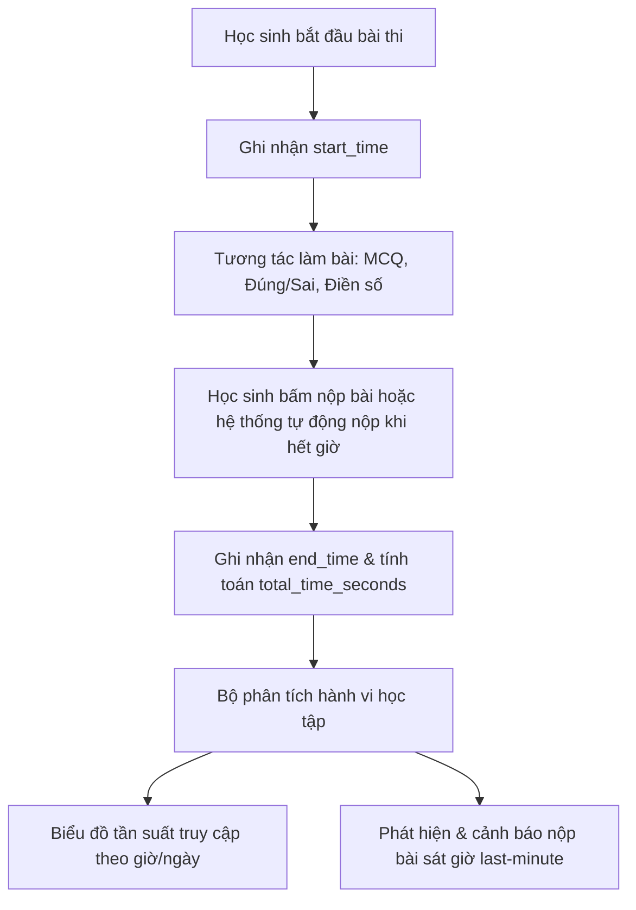
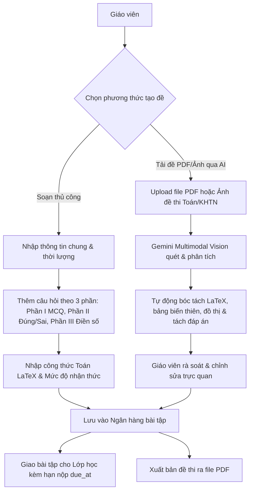
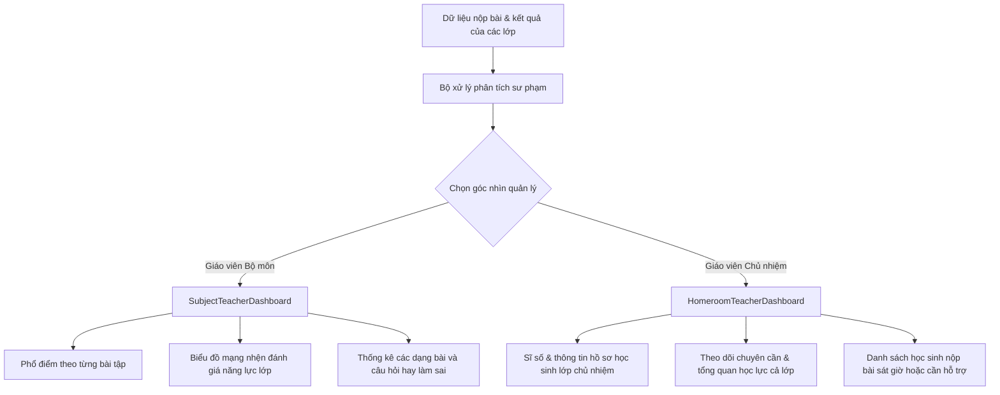
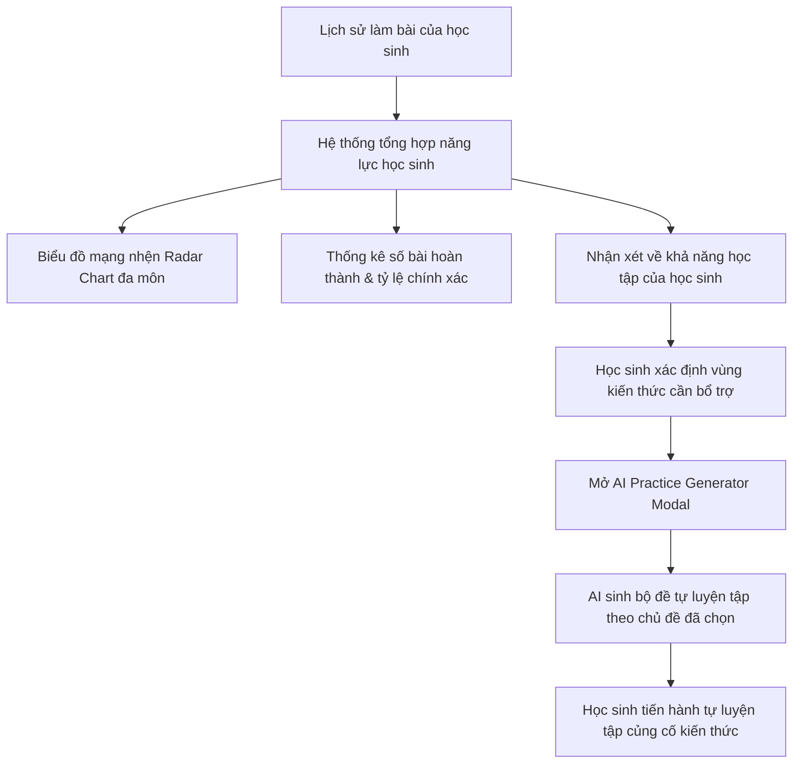
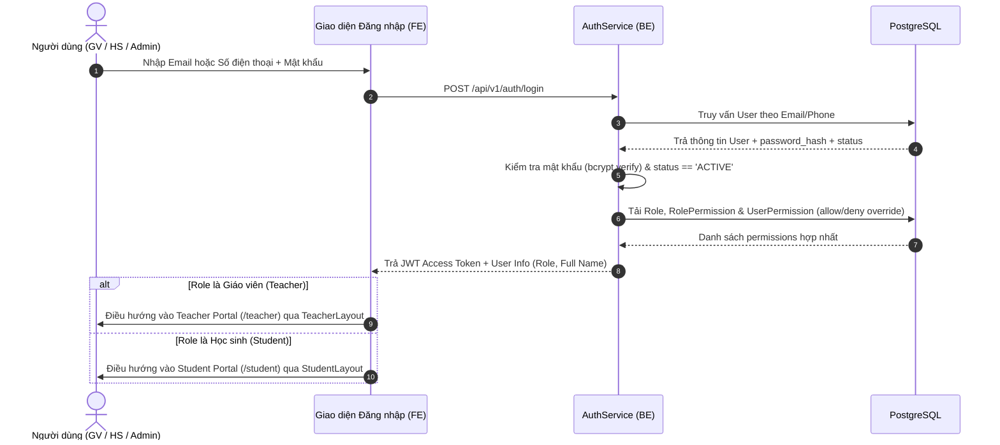
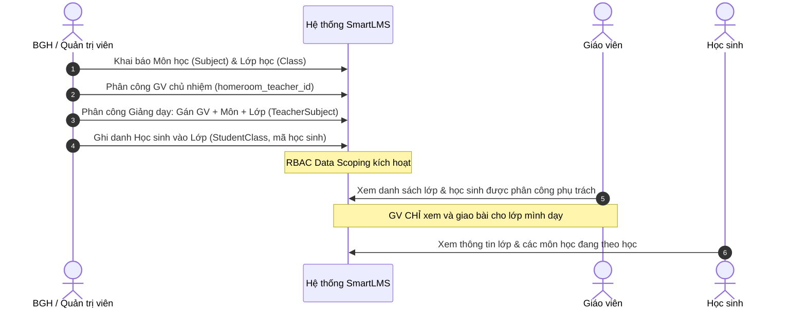
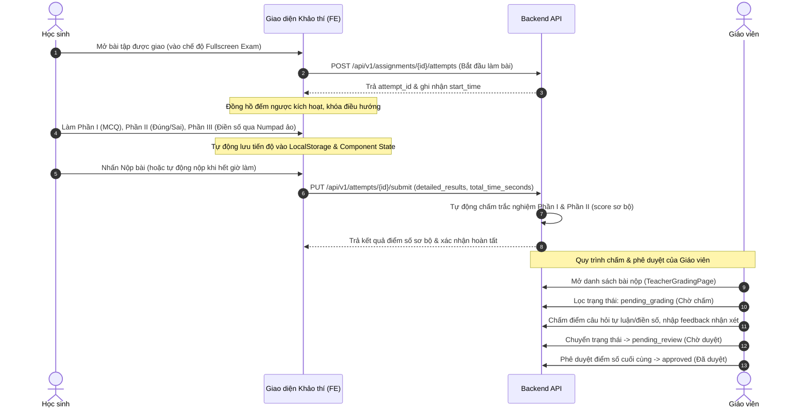
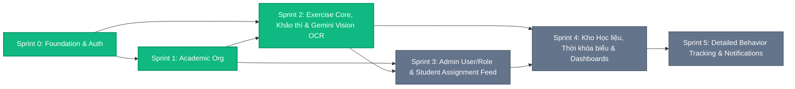

File Name: business_overview.md
Description: Tong hop nghiep vu (business), toan bo so do luong quy trinh hoat dong (Mermaid workflows), anh xa sprint va bang theo doi dong bo API BE-FE toan he thong
Created At: 2026-07-18
Created By: Tam Khang
Updated At: 2026-10-28
Updated By: Tam Khang

# Tổng quan Nghiệp vụ & Quy trình Luồng hoạt động (Workflows) — SmartLMS

> Nguồn: `docs/HỆ THỐNG QUẢN LÍ BÀI TẬP KẾT HỢP PHÂN TÍCH HÀNH VI.pdf` (SRS v1.0) kết hợp cùng hệ thống thực tế qua các Sprint (S0, S1, S2, S3, S4).  
> Mục đích tài liệu: Tổng hợp toàn bộ quy chuẩn nghiệp vụ (Business Requirements), các Use Case chính, chuẩn hóa 100% các sơ đồ luồng quy trình (Workflows) dưới dạng Mermaid và theo dõi trạng thái đồng bộ API giữa Backend và Frontend trên toàn hệ thống.

---

## 1. Bối cảnh & Vấn đề Nghiệp vụ (SRS §1.1)

| # | Vấn đề thực tế | Hệ quả nghiệp vụ | Giải pháp SmartLMS |
|---|---|---|---|
| 1 | Giáo viên không kiểm soát được tần suất và hành vi làm bài tại nhà của học sinh | Chỉ thấy kết quả cuối, không biết thời lượng làm bài thực tế, có dồn sát giờ (last-minute submission) hay không | Tự động ghi vết thời gian làm bài thực tế (`start_time`, `end_time`, `total_time_seconds`) và cảnh báo nộp bài sát giờ |
| 2 | Thiếu công cụ trực quan hóa năng lực học tập | Giáo viên & học sinh thiếu biểu đồ đa chiều để đánh giá điểm mạnh — yếu — tiến độ | Biểu đồ mạng nhện trực quan hóa năng lực và nhận xét về khả năng học tập của học sinh |
| 3 | Áp lực biên soạn bài tập, đề kiểm tra đa dạng | Soạn đề thủ công, gõ công thức Toán LaTeX, cắt dán đồ thị/hình vẽ tốn nhiều công sức | Tích hợp **AI Gemini Multimodal Vision OCR** tự động bóc tách đề thi PDF/Ảnh sang LaTeX và sinh câu hỏi chuẩn |
| 4 | Khó khăn khi áp dụng cấu trúc đề mới của Bộ GD&ĐT | Cấu trúc đề thi mới (gồm 3 phần: Trắc nghiệm, Đúng/Sai 4 ý, Trả lời ngắn) khó tổ chức và chấm thủ công | Chuẩn hóa đầy đủ 3 dạng câu hỏi trên giao diện tạo đề và phòng thi trực tuyến của học sinh |

---

## 2. Mục tiêu Chiến lược (SRS §1.3)

1. **Đo lường chi tiết hành vi học tập**: Ghi nhận thời gian bắt đầu, thời gian nộp bài, tần suất làm bài, phát hiện các trường hợp nộp bài sát giờ.
2. **Trực quan hóa năng lực lớp học**: Báo cáo đa chiều qua biểu đồ mạng nhện giúp giáo viên nắm bắt nhanh tình hình học tập.
3. **Đánh giá năng lực học tập của học sinh**: Cung cấp dữ liệu tự đánh giá và nhận xét về khả năng học tập của học sinh (hệ thống cung cấp nhận xét về năng lực học tập, không thể gợi ý lộ trình học chi tiết).
4. **Tối ưu hóa nguồn lực biên soạn**: Kết hợp biên soạn thủ công linh hoạt và ứng dụng AI nhận diện, bóc tách đề thi thông minh từ tài liệu giáo viên.

---

## 3. Phạm vi Chức năng & Sơ đồ Luồng Quy trình (Mermaid Workflows)

### 3.1. Phân hệ 1 — Tracking (Quản lý & Theo dõi Hành vi Làm bài)
- **Chức năng**: Ghi vết thời gian làm bài (bắt đầu/nộp bài), giám sát tần suất làm bài trực tuyến, cảnh báo tiến độ nộp bài và nộp bài sát giờ.
- **Luồng nghiệp vụ**: Hệ thống tự động ghi nhận thời điểm bắt đầu (`start_time`), thời điểm nộp (`end_time`) và đo tổng thời gian học sinh thực sự tương tác làm bài (`total_time_seconds`).
- **Đầu ra**: Biểu đồ tần suất truy cập theo giờ/ngày của từng học sinh, danh sách cảnh báo nộp bài sát giờ (last-minute submission).
- **Vai trò chính**: Giáo viên (tiêu thụ dữ liệu phân tích), Học sinh (nguồn phát sinh sự kiện làm bài).

---

### 3.2. Phân hệ 2 — Exercise Core & AI OCR (Ngân hàng Bài tập & Bóc tách Đề thi bằng AI)
- **Chức năng**: Quản lý kho học liệu, biên soạn bài tập theo cấu trúc 3 phần chuẩn Bộ GD&ĐT, bóc tách đề thi thông minh bằng AI Gemini Vision OCR, phê duyệt và giao bài tập cho lớp.
- **Luồng nghiệp vụ**:
  1. *Soạn đề thủ công*: Giáo viên nhập thông tin chung, tạo câu hỏi theo chuẩn 3 phần mới của Bộ GD&ĐT (Phần I: Trắc nghiệm 4 lựa chọn, Phần II: Đúng/Sai 4 ý con a-b-c-d, Phần III: Trả lời ngắn/điền số), hỗ trợ công thức Toán học chuẩn `$LaTeX$`, gắn tag mức độ nhận thức (Nhận biết, Thông hiểu, Vận dụng).
  2. *Bóc tách qua AI Gemini Multimodal Vision*: Giáo viên upload file PDF hoặc ảnh đề thi Toán/KHTN. AI tự động quét, bóc tách công thức LaTeX, nhận diện bảng biến thiên, đồ thị, hình học, tách 3 phần câu hỏi và đáp án đúng.
  3. Giáo viên rà soát, tinh chỉnh trước khi lưu vào ngân hàng đề hoặc giao bài cho lớp kèm hạn nộp (`due_at`).
- **Đầu ra**: Bộ bài tập hoàn chỉnh lưu vào kho học liệu, xuất bản đề thi dạng PDF hoặc phân bổ tới các lớp học sinh.

---

### 3.3. Phân hệ 3 — Teacher Dashboard (Dashboard Phân tích cho Giáo viên)
- **Chức năng**: Thống kê năng lực tổng quan của lớp, phân tích chi tiết hành vi cá nhân, báo cáo phổ điểm và dạng bài hay sai.
- **Luồng nghiệp vụ**:
  - **Biểu đồ mạng nhện** thể hiện năng lực và mức độ nắm vững kiến thức của lớp học.
  - Danh sách học sinh có dấu hiệu sa sút tần suất làm bài hoặc nộp sát giờ (last-minute submission).
  - Khuyến nghị sư phạm dựa trên vùng kiến thức lớp đang có tỷ lệ làm sai cao.
  - Hỗ trợ 2 góc nhìn chuyên biệt: Giáo viên bộ môn (`SubjectTeacherDashboard`) và Giáo viên chủ nhiệm (`HomeroomTeacherDashboard`).
- **Đầu ra**: Báo cáo trực quan hóa năng lực định kỳ (xuất PDF/Excel).

---

### 3.4. Phân hệ 4 — Student Dashboard (Dashboard Tự đánh giá cho Học sinh)
- **Chức năng**: Xem số liệu học tập cá nhân theo môn, theo dõi tiến độ hoàn thành bài tập, nhận xét về khả năng học tập của học sinh.
- **Luồng nghiệp vụ**:
  - Học sinh theo dõi tổng số bài đã làm, tỷ lệ chính xác, thời gian hoàn thành theo từng môn.
  - Hệ thống cung cấp **nhận xét về khả năng học tập của học sinh** dựa trên dữ liệu phân tích năng lực (hệ thống chỉ đưa ra nhận xét, đánh giá năng lực học tập, không thể gợi ý lộ trình học chi tiết).
  - Tích hợp công cụ sinh đề tự luyện tập AI cá nhân hóa giúp học sinh tự củng cố kiến thức theo chủ đề.
- **Đầu ra**: Biểu đồ mạng nhện (Radar Chart) thể hiện năng lực đa môn và nhận xét năng lực học tập.

---

### 3.5. Các Luồng Tương tác Hệ thống Cốt lõi (System Interaction Workflows)

#### A. Luồng Quản lý Tài khoản & Phân quyền (Auth & Dynamic RBAC Workflow)

#### B. Luồng Tổ chức Đào tạo & Phân công Giảng dạy (Academic Org Workflow)

#### C. Luồng Khảo thí Trực tuyến & Chấm bài 3 Trạng thái (Assessment, Submission & Grading Workflow)

---

## 4. Yêu cầu Phi chức năng & Ràng buộc Hệ thống (NFRs)

| Nhóm | Tiêu chuẩn kỹ thuật | Triển khai thực tế trong hệ thống |
|---|---|---|
| **Bảo mật & Phân quyền (Security & RBAC)** | Mã hóa toàn bộ dữ liệu cá nhân & kết quả học tập. Phân quyền RBAC nghiêm ngặt | Mọi endpoint đều kiểm tra quyền; Học sinh không xem được dữ liệu hành vi của học sinh khác; Giáo viên chỉ quản lý học sinh thuộc lớp mình phụ trách. |
| **Xóa dữ liệu (Data Policy)** | **Tuyệt đối không xóa cứng (Hard Delete)** | 100% nghiệp vụ xóa áp dụng cơ chế **Soft Delete** (`status = 'DELETED'`), bảo toàn toàn vẹn dữ liệu lịch sử và quan hệ khóa ngoại. |
| **Giao diện & Trải nghiệm (UX/UI)** | Tối giản, trực quan, responsive | Giao diện React 18, biểu đồ mạng nhện trực quan, hỗ trợ hiển thị mượt mà công thức Toán học `$LaTeX$` (qua MathJax/KaTeX), phân trang con trỏ (Keyset Cursor Pagination) tối ưu trải nghiệm người dùng. |

---

## 5. Ánh xạ Nghiệp vụ → Sprint & Hiện trạng Triển khai Chi tiết

Sơ đồ phụ thuộc kỹ thuật và lộ trình thực thi giữa các Sprint trong hệ thống:

| Sprint | Phân hệ nghiệp vụ | Specs & Tasks liên quan | Phạm vi triển khai kỹ thuật & nghiệp vụ thực tế | Trạng thái |
|---|---|---|---|---|
| **Sprint 0** | Foundation & Auth (Hạ tầng kỹ thuật & Bảo mật) | [sprint_0_overview.md](sprints/sprint_0_overview.md) [f_fnd_01_spec.md](specs/f_fnd_01_spec.md) [f_auth_01_spec.md](specs/f_auth_01_spec.md) | Dựng khung Backend FastAPI, kết nối PostgreSQL qua SQLAlchemy 2.0 & Alembic, Docker hóa toàn bộ hệ thống (BE, FE, DB). Thiết kế mô hình RBAC động (`roles`, `users`, `permissions`, `role_permissions`, `user_permissions`), cơ chế xác thực JWT (`login`, `me`, `logout`, `change-password`, `register`), bảo vệ endpoint theo permission code (`require_perm`). | ✅ Hoàn thành (`done`) |
| **Sprint 1** | Academic Org (Cơ cấu tổ chức đào tạo) | [sprint_1_overview.md](sprints/sprint_1_overview.md) [f_acad_01_subjects_spec.md](specs/f_acad_01_subjects_spec.md) [f_acad_02_classes_spec.md](specs/f_acad_02_classes_spec.md) [f_acad_03_enrollment_spec.md](specs/f_acad_03_enrollment_spec.md) [f_acad_04_teacher_assignment_spec.md](specs/f_acad_04_teacher_assignment_spec.md) | Xây dựng nghiệp vụ CRUD, Soft Delete & Khôi phục (Restore) danh mục môn học (`subjects`), lớp học (`classes`), ghi danh học sinh (`student_class`), phân công chuyên môn giáo viên (`teacher_subjects`) và gán giáo viên chủ nhiệm (`homeroom_teacher_id`). Thiết lập cơ chế **RBAC Data Scoping**. *(Lưu ý: 13 endpoints ghi/xóa/khôi phục đã xong ở BE nhưng cần đồng bộ vào `api.js` ở Sprint 3)*. | ✅ BE Hoàn thành (`done`) ⚠️ FE đồng bộ 1 phần |
| **Sprint 2** | Bài tập lõi, Khảo thí & AI Gemini Vision OCR | [sprint_2_overview.md](sprints/sprint_2_overview.md) [f_exe_01_exercises_spec.md](specs/f_exe_01_exercises_spec.md) [f_exe_02_assignments_spec.md](specs/f_exe_02_assignments_spec.md) [f_exe_03_submission_spec.md](specs/f_exe_03_submission_spec.md) [f_exe_04_grading_spec.md](specs/f_exe_04_grading_spec.md) [f_exe_05_question_import_spec.md](specs/f_exe_05_question_import_spec.md) [f_exe_06_gemini_vision_ocr_spec.md](specs/f_exe_06_gemini_vision_ocr_spec.md) | • **Soạn đề & Ngân hàng câu hỏi**: Hỗ trợ cấu trúc 3 phần chuẩn Bộ GD&ĐT (MCQ, Đúng/Sai, Trả lời ngắn), công thức `$LaTeX$`, Keyset Cursor Pagination, xuất đề PDF (`/export/pdf`). • **AI Gemini Vision OCR (`F-EXE-06`)**: Tích hợp Gemini Multimodal Vision + `pypdfium2` tự động bóc tách đề thi Toán/KHTN phức tạp kèm đáp án. • **Giao bài & Khảo thí**: Giao bài cho lớp (`class_assignments`), phòng thi trực tuyến Fullscreen, tự động chấm điểm trắc nghiệm & giáo viên cập nhật điểm (`/grade`). | ✅ Hoàn thành (`done`) |
| **Sprint 3** | Quản trị Người dùng, Phân quyền & Cổng Bài tập Học sinh | [sprint_3_overview.md](sprints/sprint_3_overview.md) [f_admin_01_user_management_spec.md](specs/f_admin_01_user_management_spec.md) [f_admin_02_role_permissions_spec.md](specs/f_admin_02_role_permissions_spec.md) [f_student_01_assignment_feed_spec.md](specs/f_student_01_assignment_feed_spec.md) | • **Admin User Management (`F-ADMIN-01`)**: 10 API CRUD, lọc đa tiêu chí, khóa/mở khóa, reset mật khẩu, import/export Excel, soft delete & restore. • **Admin Role & Permissions (`F-ADMIN-02`)**: 5 API quản lý ma trận phân quyền Role và ghi đè quyền cá nhân (`user_permissions`). • **Student Unified Assignment Feed (`F-STUDENT-01`)**: Endpoint `GET /api/v1/student/assignments` thay thế luồng gọi N+1 ở `StudentExercisesPage.jsx`. • **Sync 11 API Sprint 0–2**: Đưa toàn bộ API `classes`, `subjects`, `enrollments`, `teacher-subjects` vào `api.js` và nối vào `AdminClassesPage.jsx` / `TeacherHomeroomPage.jsx`. | 📋 Kế hoạch (`planning`) |
| **Sprint 4** | Kho Học liệu, Thời khóa biểu & Bảng Điều khiển Phân tích | [sprint_4_overview.md](sprints/sprint_4_overview.md) [f_doc_01_document_repository_spec.md](specs/f_doc_01_document_repository_spec.md) [f_acad_05_teacher_schedule_spec.md](specs/f_acad_05_teacher_schedule_spec.md) [f_dash_01_teacher_dashboard_spec.md](specs/f_dash_01_teacher_dashboard_spec.md) [f_dash_02_student_dashboard_spec.md](specs/f_dash_02_student_dashboard_spec.md) | • **Document Repository (`F-DOC-01`)**: 8 API upload, phân loại, xem trước, tải về, xóa mềm & khôi phục học liệu số. • **Teacher Schedule & Notes (`F-ACAD-05`)**: 11 API quản lý thời khóa biểu, phát hiện trùng lịch, gắn nhãn khẩn cấp (`urgency`) và ghi chú công việc. • **Dashboards & AI Practice (`F-DASH-01`, `F-DASH-02`)**: API thống kê biểu đồ mạng nhện (Radar Chart) 6 trục cho GV/HS, nhận xét năng lực học tập và API sinh câu hỏi tự luyện bằng AI. | 📋 Kế hoạch (`planning`) |
| **Sprint 5** | Detailed Behavior Tracking, Notifications & System Settings | SRS Module 1 — Tracking & System Ops | • Theo dõi chuyên sâu hành vi làm bài (`behavior_logs`, `focus_score`), thống kê tần suất truy cập. • Hệ thống Thông báo (`notifications`), Hỏi đáp (`QADiscussionModal`) và các API Báo cáo / Cấu hình hệ thống cho Admin (`AdminDashboard`, `AdminReportsPage`, `AdminSettingsPage`). | 📋 Kế hoạch (`planning`) |

---

## 6. Bảng Tổng hợp Trạng thái Đồng bộ API Backend ↔ Frontend Toàn Hệ thống

### 6.1. Thống kê theo Màn hình Frontend (19 Pages)

| # | Phân hệ | Màn hình (File Page) | Trạng thái Kết nối API | Chi tiết API Đã nối / Còn thiếu |
|:---:|:---|:---|:---:|:---|
| 1 | **Public** | `LoginPage.jsx` | ✅ **100% Real API** | Đã nối `authApi.login` và `authApi.getMe`. |
| 2 | **Teacher** | `ExerciseRepositoryPage.jsx` | ✅ **90% Real API** | Đã nối `exercisesApi.getExercises` (Keyset Pagination), `deleteExercise`, `subjectsApi.getSubjects`. Thiếu nối `updateExercise` khi bấm sửa trên thẻ (đang mở `EditDocumentModal` mock) và chưa có nút gọi `restoreExercise`. |
| 3 | **Teacher** | `CreateExerciseManualPage.jsx` | ✅ **100% Real API** | Đã nối `exercisesApi.createExercise`, `exercisesApi.addQuestion`, `subjectsApi.getSubjects`. |
| 4 | **Teacher** | `TeacherClassesPage.jsx` | ✅ **100% Real API** | Đã nối `classesApi.getClasses`, `getStudentsInClass`, `getTeacherSubjects`, `subjectsApi.getSubjects`. |
| 5 | **Teacher** | `TeacherClassDetailPage.jsx` | ⚠️ **Hybrid (75% API)** | Đã nối `getClassDetail`, `getStudentsInClass`, `getTeacherSubjects`, `getClassAssignments`, `deleteAssignment`. Điểm GPA học sinh và modal `StudentDetailModal` vẫn đang dùng dữ liệu tĩnh. |
| 6 | **Teacher** | `TeacherHomeroomPage.jsx` | ⚠️ **Hybrid (60% API)** | Đã nối `getClasses`, `getStudentsInClass`. Điểm trung bình (8.2) & điểm môn học đang gán cứng; các modal `AddStudentModal` (chưa gọi `POST /classes/{id}/students`), `EditStudentInfoModal`, `EditStudentGradesModal` mới chỉ lưu state RAM. |
| 7 | **Teacher** | `TeacherGradingPage.jsx` | ⚠️ **Hybrid (75% API)** | Đã nối `attemptsApi.getAttempts`, `getAttemptDetail`, `updateGrade` và `exercisesApi.getExerciseDetail`. Đang trộn chung với 15 bản ghi mock; tính năng "Cascade Regrade" khi đổi đáp án gốc mới xử lý ở state FE. |
| 8 | **Teacher** | `TeacherProfilePage.jsx` | ⚠️ **Hybrid (60% API)** | Đã nối `authApi.getMe` và `authApi.changePassword`. Nút "Lưu thông tin cá nhân" mới chỉ lưu state FE (thiếu `PUT /api/v1/auth/me`). |
| 9 | **Teacher** | `DocumentRepositoryPage.jsx` | ❌ **100% Mock Data** | Chờ xây dựng 8 API `/api/v1/documents/*` (`F-DOC-01` — Sprint 4). |
| 10 | **Teacher** | `TeacherSchedulePage.jsx` | ❌ **100% Mock Data** | Chờ xây dựng 11 API `/api/v1/teacher/schedules/*` & `/notes/*` (`F-ACAD-05` — Sprint 4). |
| 11 | **Teacher** | `TeacherDashboard.jsx` (`Homeroom` & `Subject`) | ❌ **100% Mock Data** | Chờ xây dựng API Dashboard phân tích giáo viên (`F-DASH-01` — Sprint 4). |
| 12 | **Student** | `StudentExerciseTakingPage.jsx` | ✅ **95% Real API** | Đã nối `exercisesApi.getExerciseDetail`, `attemptsApi.startAttempt`, `submitAttempt`, `getAttempts`, `getAttemptDetail` (chỉ fallback localStorage đối với bài tự luyện AI). |
| 13 | **Student** | `StudentExercisesPage.jsx` | ⚠️ **Hybrid (65% API)** | Đang gọi vòng N+1 (`getClasses` -> `getClassAssignments` -> `getAttempts`), chờ thay bằng `GET /api/v1/student/assignments` (`F-STUDENT-01` — Sprint 3). Tính năng "AI Practice Generator" đang dùng `setTimeout` + `localStorage`. |
| 14 | **Student** | `StudentDashboard.jsx` | ❌ **100% Mock Data** | Chờ xây dựng API Dashboard tự đánh giá học sinh (`F-DASH-02` — Sprint 4). |
| 15 | **Admin** | `AdminClassesPage.jsx` | ❌ **100% Mock Data** | **Backend đã có sẵn 15 API** (`classes`, `enrollments`, `teacher-subjects`) từ Sprint 1 nhưng FE chưa khai báo đầy đủ trong `api.js` và chưa nối vào trang này. |
| 16 | **Admin** | `AdminUsersPage.jsx` | ❌ **100% Mock Data** | Chờ xây dựng 10 API `/api/v1/admin/users/*` (`F-ADMIN-01` — Sprint 3). |
| 17 | **Admin** | `AdminRolesPage.jsx` | ❌ **100% Mock Data** | Chờ xây dựng 5 API `/api/v1/admin/roles/*` & `/permissions` (`F-ADMIN-02` — Sprint 3). |
| 18 | **Admin** | `AdminDashboard.jsx` | ❌ **100% Mock Data** | Chưa có API thống kê hệ thống, hàng đợi phê duyệt và nhật ký kiểm toán (Audit Logs). |
| 19 | **Admin** | `AdminReportsPage.jsx` & `AdminSettingsPage.jsx` | ❌ **100% Mock Data** | Chưa có API báo cáo phân tích toàn trường và API lưu cấu hình hệ thống. |

---

## 7. Danh mục Tài liệu Tham chiếu

- **SRS gốc**: [docs/HỆ THỐNG QUẢN LÍ BÀI TẬP KẾT HỢP PHÂN TÍCH HÀNH VI.pdf](../HỆ%20THỐNG%20QUẢN%20LÍ%20BÀI%20TẬP%20KẾT%20HỢP%20PHÂN%20TÍCH%20HÀNH%20VI.pdf)
- **Kiến trúc hệ thống**: [docs/architecture.md](../architecture.md)
- **Mô hình Dữ liệu ORM**: [backend/models/models.py](../../backend/models/models.py)
- **Chi tiết Sprint 0**: [sprint_0_overview.md](sprints/sprint_0_overview.md)
- **Chi tiết Sprint 1**: [sprint_1_overview.md](sprints/sprint_1_overview.md)
- **Chi tiết Sprint 2**: [sprint_2_overview.md](sprints/sprint_2_overview.md)
- **Chi tiết Sprint 3**: [sprint_3_overview.md](sprints/sprint_3_overview.md)
- **Chi tiết Sprint 4**: [sprint_4_overview.md](sprints/sprint_4_overview.md)
- **Đặc tả AI Gemini Vision OCR**: [f_exe_06_gemini_vision_ocr_spec.md](specs/f_exe_06_gemini_vision_ocr_spec.md)

---

## 8. Báo cáo Rà soát Hiện trạng Thực thi & Khoảng cách Kỹ thuật BE — FE (Implementation Gap Audit)

> **Cập nhật ngày:** `2026-09-30` · **Người thực hiện:** `Tam Khang`  
> **Căn cứ rà soát:** Đối chiếu toàn diện giữa tài liệu Nghiệp vụ (`business_overview.md`), Mô hình CSDL (`models.py`), Router API Backend (`FastAPI`) và các Trang giao diện Frontend (`React Vite`).

### 7.1. Bảng Tổng hợp Tình trạng Triển khai các Chức năng Nghiệp vụ

| STT | Phân hệ / Nghiệp vụ trong Business Overview | Trạng thái BE | Trạng thái FE | Đã nối API? | Đánh giá & Khoảng cách Kỹ thuật |
|---|---|:---:|:---:|:---:|---|
| **1** | **Xác thực & RBAC Cơ bản** (`/api/v1/auth`) | ✅ Sẵn sàng | ✅ Sẵn sàng | 🟢 Đã nối 100% | Đăng nhập JWT, lấy thông tin cá nhân (`/auth/me`), đổi mật khẩu, đăng xuất. |
| **2** | **Bảng điều khiển Quản trị** (`/admin`) | ✅ Sẵn sàng | ✅ Sẵn sàng | 🟢 Đã nối 100% | Thống kê số lượng (`stats`), biểu đồ truy cập (`activity-chart`), hàng chờ duyệt (`requests` - Duyệt/Từ chối), nhật ký hệ thống (`audit-logs`). |
| **3** | **Quản lý Người dùng** (`/admin/users`) | ✅ Sẵn sàng | ✅ Sẵn sàng | 🟢 Đã nối 100% | Danh sách phân trang, tìm kiếm, tạo mới có sinh mã, sửa, khóa/mở khóa (`status`), xóa mềm (`status = 'DELETED'`), khôi phục, đổi mật khẩu, xuất/nhập Excel. |
| **4** | **Quản lý Trường lớp** (`/admin/classes`) | ✅ Sẵn sàng | ⚠️ Mock UI | 🔴 **Chưa nối FE** | BE đã có đầy đủ API CRUD lớp, ghi danh học sinh, phân công giáo viên (`/api/v1/classes`). Tuy nhiên giao diện `AdminClassesPage.jsx` chưa gọi `classesApi` mà dùng mảng dữ liệu mẫu. |
| **5** | **Phân quyền & Vai trò** (`/admin/roles`) | ❌ Chưa có API | ⚠️ Mock UI | 🔴 **Chưa nối BE & FE** | Bảng CSDL `roles`, `permissions`, `role_permissions` đã có, nhưng chưa viết router FastAPI `/api/v1/admin/roles` và `/api/v1/admin/permissions`. FE có UI ma trận quyền hoàn chỉnh nhưng đang chạy local state. |
| **6** | **Báo cáo & Thống kê Quản trị** (`/admin/reports`) | ❌ Chưa có API | ⚠️ Mock UI | 🔴 **Chưa nối BE & FE** | Chưa có router BE tổng hợp phổ điểm toàn trường, phân bố thang đo Bloom và học sinh có nguy cơ sa sút. FE `AdminReportsPage.jsx` hiển thị dữ liệu giả định. |
| **7** | **Cài đặt Hệ thống Quản trị** (`/admin/settings`) | ❌ Chưa có API | ⚠️ Mock UI | 🔴 **Chưa nối BE & FE** | Chưa có bảng CSDL cấu hình và router `/api/v1/admin/settings`. FE `AdminSettingsPage.jsx` chạy dữ liệu mẫu. |
| **8** | **Ngân hàng Học liệu & Tài liệu** (`/teacher/documents`) | ✅ Sẵn sàng | ✅ Sẵn sàng | 🟢 Đã nối 100% | Upload file, download, xóa mềm, khôi phục, chỉ số dung lượng lưu trữ. |
| **9** | **Ngân hàng Bài tập & Bóc tách AI OCR** (`/teacher/exercises`) | ✅ Sẵn sàng | ✅ Sẵn sàng | 🟢 Đã nối 100% | Soạn đề 3 phần (MCQ, Đúng/Sai, Điền số, LaTeX), import file docx/pdf, bóc tách đề thi bằng Gemini Vision OCR, xuất bản đề thi ra PDF. |
| **10** | **Giao bài tập cho Lớp** (`/teacher/classes`) | ✅ Sẵn sàng | ✅ Sẵn sàng | 🟢 Đã nối 100% | Giao bài tập kèm hạn nộp (`due_at`), thời lượng làm bài, số lần nộp tối đa. |
| **11** | **Khảo thí Trực tuyến của Học sinh** (`/student/exercises`) | ✅ Sẵn sàng | ✅ Sẵn sàng | 🟢 Đã nối 100% | Danh sách bài được giao, giao diện phòng thi độc lập toàn màn hình, đồng hồ đếm ngược, bàn phím số ảo, tự động chấm sơ bộ MCQ & Đúng/Sai khi nộp bài. |
| **12** | **Quy trình Chấm bài 3 Trạng thái** (`/teacher/grading`) | ✅ Sẵn sàng | ✅ Sẵn sàng | 🟢 Đã nối 100% | Lấy danh sách bài nộp, lọc theo lớp/môn, chấm điểm tự luận/điền số, phản hồi nhận xét, chuyển trạng thái `pending_grading` $\rightarrow$ `pending_review` $\rightarrow$ `approved`. |
| **13** | **Dashboard Giáo viên Bộ môn** (`SubjectTeacherDashboard`) | ✅ Sẵn sàng | ✅ Sẵn sàng | 🟢 Đã nối 100% | Đã nối endpoint `/api/v1/teacher/dashboard` và `/api/v1/teacher/schedules`, hiển thị thống kê bài chờ chấm, phổ điểm, lịch dạy và bài nộp gần đây. |
| **14** | **Dashboard Giáo viên Chủ nhiệm** (`HomeroomTeacherDashboard`) | ✅ Sẵn sàng | ✅ Sẵn sàng | 🟢 Đã nối 100% | Đã nối endpoint `/api/v1/teacher/dashboard` và `/api/v1/classes/{class_id}/students`, hiển thị đầy đủ danh sách học sinh, điểm TB, chuyên cần và cảnh báo học sinh sa sút. |
| **15** | **Dashboard Học sinh & Radar Đa môn** (`StudentDashboard`) | ✅ Sẵn sàng | ✅ Sẵn sàng | 🟢 Đã nối 100% | Đã nối `/api/v1/student/dashboard/radar`, `/api/v1/student/dashboard/feedback` và lịch học tập tuần. |
| **16** | **AI Practice Generator Modal** (Học sinh tự sinh đề luyện tập) | ✅ Sẵn sàng | ✅ Sẵn sàng | 🟢 Đã nối 100% | Đã nối endpoint AI Gemini sinh đề tự luyện tập theo chủ đề và độ khó (`POST /api/v1/exercises/ai-generate`). |
| **17** | **Tracking Chi tiết Hành vi Làm bài** (Phân hệ 1) | ⚠️ Một phần | ⚠️ Mock UI | 🔴 **Chưa nối BE & FE** | BE chỉ mới lưu `start_time`, `end_time`, `total_time_seconds`. Chưa có bảng & endpoint ghi vết thời gian dừng ở từng câu hỏi, chưa có thuật toán tự động nhận diện và gắn cờ nộp bài sát giờ (`last-minute submission`). |

### 8.2. Danh sách Chi tiết các API Backend chưa được nối vào Frontend

1. **Academic Classes Management API**:
   - `POST /api/v1/classes`: Tạo lớp học mới (chưa nối vào modal Thêm Lớp của `AdminClassesPage.jsx`).
   - `PUT /api/v1/classes/{class_id}`: Cập nhật thông tin lớp học (chưa nối vào modal Sửa Lớp).
   - `DELETE /api/v1/classes/{class_id}`: Xóa mềm lớp học (chưa nối vào nút Xóa Lớp).
   - `POST /api/v1/classes/{class_id}/restore`: Khôi phục lớp đã xóa.
   - `POST /api/v1/classes/{class_id}/teacher-subjects`: Phân công giáo viên bộ môn cho lớp.
   - `DELETE /api/v1/classes/{class_id}/teacher-subjects/{id}`: Hủy phân công giáo viên bộ môn.

### 8.3. Danh sách Chi tiết các Trang Frontend chưa có API Backend tương ứng

1. **Phân quyền & Vai trò (`AdminRolesPage.jsx`)**:
   - Thiếu `GET /api/v1/admin/roles` (Danh sách vai trò & số lượng thành viên).
   - Thiếu `GET /api/v1/admin/permissions` (Danh mục quyền hệ thống).
   - Thiếu `PUT /api/v1/admin/roles/{role_id}/permissions` (Cập nhật quyền cho vai trò).
   - Thiếu `GET /api/v1/admin/users/{user_id}/permissions` và `PUT /api/v1/admin/users/{user_id}/permissions` (Ghi đè quyền cho từng cá nhân).
2. **Báo cáo & Thống kê Toàn trường (`AdminReportsPage.jsx`)**:
   - Thiếu `GET /api/v1/admin/reports/gpa-distribution` (Phổ điểm GPA theo khối 10, 11, 12).
   - Thiếu `GET /api/v1/admin/reports/bloom-taxonomy` (Tỷ lệ phân bổ câu hỏi theo thang nhận thức Bloom).
   - Thiếu `GET /api/v1/admin/reports/at-risk-students` (Danh sách học sinh có nguy cơ sa sút cần can thiệp sớm).
3. **Cài đặt Hệ thống (`AdminSettingsPage.jsx`)**:
   - Thiếu API lưu trữ cấu hình trường học, năm học và chính sách bảo mật.
