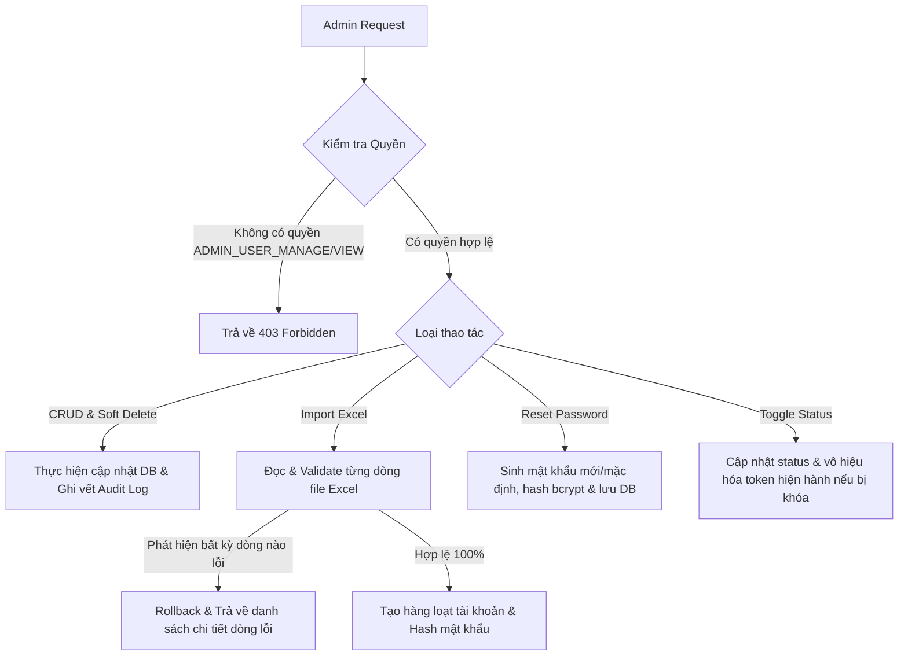

# Feature Spec — `F-ADMIN-01` Admin User Management (Quản lý Tài khoản & Phân loại)

> Path: `docs/v_1/specs/f_admin_01_user_management_spec.md` · Sprint: [sprint_3_overview.md](../sprints/sprint_3_overview.md)  
> Created At: `2026-09-23`  
> Created By: `Tam Khang`  
> Updated At: `2026-09-23`  
> Updated By: `Tam Khang`  

---

## Document Header

| Field | Giá trị |
|---|---|
| **Feature ID** | `F-ADMIN-01` |
| **Feature Name** | Admin User Management — Quản lý Tài khoản & Hồ sơ Người dùng |
| **Module(s)** | `admin`, `auth` |
| **Sprint(s) Allocated** | `SPRINT-03` |
| **Spec Version** | `v1.0` |
| **Last Updated** | `2026-09-23` |
| **Source Binding** | `models/models.py` (bảng `users`, `roles`) · `f_auth_01_spec.md` · `.claude/rules/coding_rules.md` |

---

# PART A — Business & Requirements

> **Owner:** Tam Khang · **Gate:** G3

## A.1 Feature Summary

Cung cấp cho **Quản trị viên (Admin)** công cụ quản lý toàn diện danh sách người dùng trong hệ thống trường học:
* Tạo mới, tra cứu (tìm kiếm theo tên, email, username, mã định danh), lọc nâng cao (theo vai trò `Admin`/`Teacher`/`Student`, khối lớp, tổ chuyên môn, trạng thái tài khoản).
* Cập nhật thông tin hồ sơ, phân loại và phân quyền ban đầu.
* Khóa / mở khóa tài khoản tức thời (`ACTIVE`, `INACTIVE`, `SUSPENDED`).
* Đặt lại mật khẩu mặc định (Reset Password).
* Xóa mềm (`status = 'DELETED'`) và khôi phục tài khoản (`POST /api/v1/admin/users/{id}/restore`).
* Import danh sách người dùng hàng loạt từ file Excel/CSV theo cơ chế **All-or-Nothing** và Export danh sách người dùng ra định dạng `.xlsx`.

## A.2 User Stories

| Story ID | As (Role) | I Want (Capability) | So That (Value) |
|---|---|---|---|
| **US-01** | Admin | Xem danh sách người dùng có phân trang, tìm kiếm và lọc linh hoạt | Quản lý và tra cứu thông tin nhanh chóng |
| **US-02** | Admin | Thêm mới từng tài khoản học sinh, giáo viên hoặc quản trị viên | Cấp quyền truy cập hệ thống cho nhân sự mới |
| **US-03** | Admin | Chỉnh sửa thông tin hồ sơ, phòng ban, khối lớp của người dùng | Duy trì dữ liệu chính xác khi có thay đổi |
| **US-04** | Admin | Khóa hoặc tạm dừng tài khoản (`SUSPENDED` / `INACTIVE`) | Đảm bảo an ninh khi tài khoản có dấu hiệu bất thường |
| **US-05** | Admin | Đặt lại mật khẩu cho tài khoản người dùng | Hỗ trợ học sinh/giáo viên khi quên mật khẩu |
| **US-06** | Admin | Xóa mềm tài khoản và khôi phục khi cần thiết | Dọn dẹp danh mục mà không làm mất lịch sử học tập/làm bài |
| **US-07** | Admin | Import danh sách học sinh/giáo viên từ file Excel | Tiết kiệm thời gian khởi tạo đầu năm học |
| **US-08** | Admin | Xuất danh sách người dùng ra file Excel | Báo cáo và lưu trữ hồ sơ trường học ngoại tuyến |

## A.3 Business Workflow (Luồng nghiệp vụ)



---

# PART B — Technical Specifications & API Contracts

## B.1 API Endpoints

### 1. `GET /api/v1/admin/users`
* **Permission**: `ADMIN_USER_VIEW`
* **Query Params**:
  * `page` (int, default=1), `page_size` (int, default=10, max=100)
  * `search` (string, optional - tìm kiếm theo `username`, `full_name`, `email`, `phone_number`)
  * `role` (string, optional - `all` | `student` | `teacher` | `admin`)
  * `status` (string, optional - `all` | `ACTIVE` | `INACTIVE` | `SUSPENDED` | `DELETED`)
  * `grade` (string, optional - khối lớp)
  * `department` (string, optional - tổ bộ môn)
* **Response `200 OK`**:
```json
{
  "items": [
    {
      "id": "3fa85f64-5717-4562-b3fc-2c963f66afa6",
      "username": "nguyenvana",
      "email": "vana@school.edu.vn",
      "full_name": "Nguyễn Văn A",
      "phone_number": "0912345678",
      "role": "Teacher",
      "status": "ACTIVE",
      "department": "Tổ Toán - Tin",
      "created_at": "2026-09-01T08:00:00Z",
      "updated_at": "2026-09-20T10:30:00Z"
    }
  ],
  "total": 128,
  "page": 1,
  "page_size": 10,
  "total_pages": 13
}
```

### 2. `POST /api/v1/admin/users`
* **Permission**: `ADMIN_USER_MANAGE`
* **Request Body**:
```json
{
  "username": "tranthib",
  "email": "thib@school.edu.vn",
  "password": "InitialPassword@123",
  "full_name": "Trần Thị B",
  "phone_number": "0987654321",
  "role": "Student",
  "status": "ACTIVE",
  "grade": "10",
  "class_name": "10A1"
}
```
* **Response `201 Created`**: User Object.

### 3. `PUT /api/v1/admin/users/{user_id}`
* **Permission**: `ADMIN_USER_MANAGE`
* **Request Body**: Cập nhật `full_name`, `email`, `phone_number`, `role`, `department`, `grade`.
* **Response `200 OK`**: User Object đã cập nhật.

### 4. `PATCH /api/v1/admin/users/{user_id}/status`
* **Permission**: `ADMIN_USER_MANAGE`
* **Request Body**: `{"status": "SUSPENDED"}`
* **Response `200 OK`**: User Object kèm trạng thái mới.

### 5. `DELETE /api/v1/admin/users/{user_id}`
* **Permission**: `ADMIN_USER_MANAGE`
* **Response `204 No Content`** (Thực hiện Soft Delete chuyển `status = 'DELETED'`).

### 6. `POST /api/v1/admin/users/{user_id}/restore`
* **Permission**: `ADMIN_USER_MANAGE`
* **Response `200 OK`**: Khôi phục `status = 'ACTIVE'`.

### 7. `POST /api/v1/admin/users/{user_id}/reset-password`
* **Permission**: `ADMIN_USER_MANAGE`
* **Request Body**: `{"new_password": "NewSecretPassword@123"}` (tùy chọn, nếu để trống hệ thống tự sinh mật khẩu ngẫu nhiên an toàn).
* **Response `200 OK`**: `{"message": "Password reset successfully", "temporary_password": "..."}`.

### 8. `POST /api/v1/admin/users/import-excel`
* **Permission**: `ADMIN_USER_MANAGE`
* **Payload**: `multipart/form-data` chứa file `.xlsx` / `.csv`.
* **Response `200 OK`**:
```json
{
  "total_processed": 45,
  "successful_count": 45,
  "errors": []
}
```
* **Response `422 Unprocessable Entity`** (Nếu có dòng lỗi):
```json
{
  "code": "ERR-ADMIN-EXCEL_ROW_VALIDATION_FAILED",
  "message": "Import rejected due to validation errors",
  "errors": [
    { "row": 5, "field": "email", "reason": "Invalid email format" },
    { "row": 12, "field": "username", "reason": "Duplicate username: 'nguyenb'" }
  ]
}
```

### 9. `GET /api/v1/admin/users/export-excel`
* **Permission**: `ADMIN_USER_VIEW`
* **Query Params**: Các bộ lọc tương tự như API danh sách.
* **Response `200 OK`**: File stream `application/vnd.openxmlformats-officedocument.spreadsheetml.sheet`.
