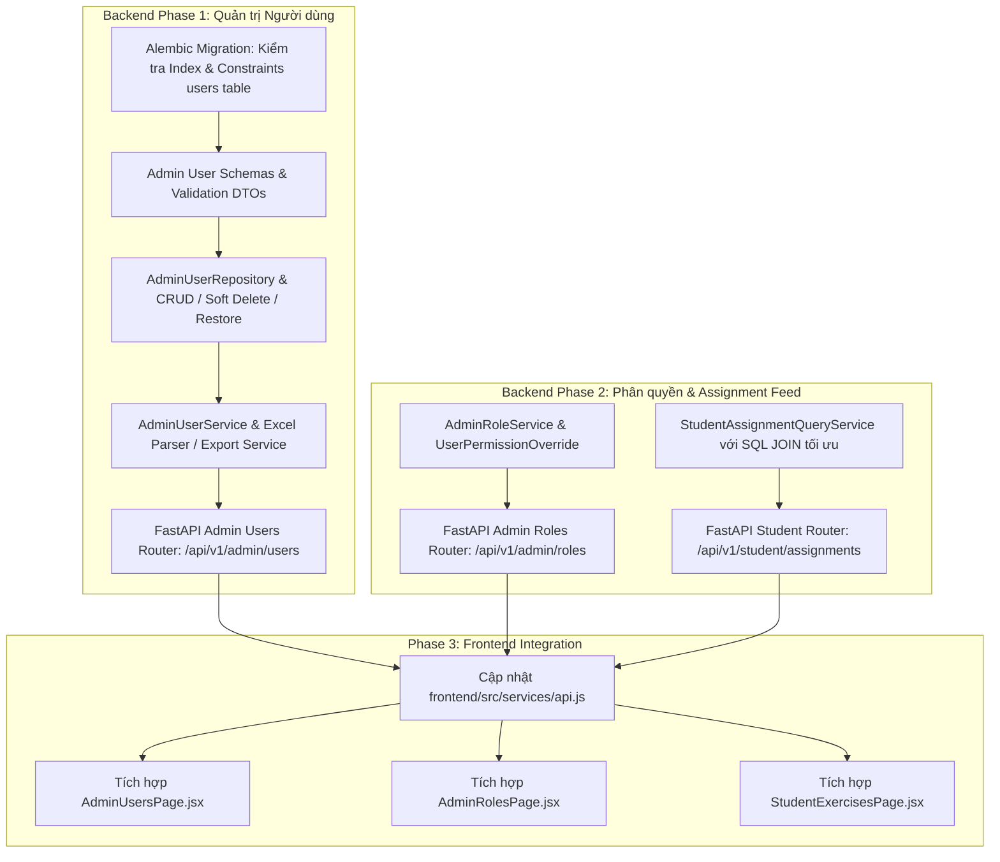

# Sprint 3 — Quản trị Người dùng & Cổng Bài tập Học sinh (Admin User Management & Student Assignment Feed)

> Path: `docs/v_1/sprints/sprint_3_overview.md` · Module(s): `admin`, `auth`, `exercise`  
> Created At: `2026-09-23`  
> Created By: `Tam Khang`  
> Updated At: `2026-09-23`  
> Updated By: `Tam Khang`  

---

## 1. Mục tiêu Sprint (Sprint Objectives)

Triển khai nhóm tính năng **Ưu tiên 1 (Priority 1)** nhằm hoàn thiện hạ tầng dữ liệu quản trị cốt lõi và tối ưu hóa luồng tải dữ liệu bài tập cho học sinh, giải quyết dứt điểm tình trạng Frontend phải sử dụng Mock Data ở cổng Admin và gọi API vòng qua nhiều lớp ở cổng Học sinh:

1. **Phân hệ Quản trị Người dùng (Admin User Management)**: Xây dựng toàn bộ các API CRUD, lọc đa tiêu chí, phân trang, khóa/mở khóa tài khoản, reset mật khẩu, import/export Excel, xóa mềm (Soft Delete) và khôi phục (Restore) người dùng cho toàn hệ thống.
2. **Phân hệ Phân quyền Quản trị (Admin Role & Permission Management)**: Cung cấp API quản lý ma trận quyền hạn (Permission Matrix) theo vai trò (`Admin`, `Teacher`, `Student`) và cơ chế ghi đè quyền hạn riêng biệt theo từng tài khoản (`user_permissions`).
3. **Cổng Bài tập Tập trung cho Học sinh (Student Unified Assignment Feed)**: Cung cấp endpoint tối ưu hóa một chạm (`GET /api/v1/student/assignments`) giúp học sinh tải toàn bộ danh sách bài tập đã được giao từ tất cả các lớp đang theo học, tổng hợp sẵn trạng thái nộp bài, thời hạn, số lần làm và điểm số cao nhất.
4. **Tích hợp Frontend**: Kết nối trực tiếp [frontend/src/services/api.js](file:///e:/tk_teacher_assistance_system/frontend/src/services/api.js) với các màn hình [AdminUsersPage.jsx](file:///e:/tk_teacher_assistance_system/frontend/src/pages/admin/AdminUsersPage.jsx), [AdminRolesPage.jsx](file:///e:/tk_teacher_assistance_system/frontend/src/pages/admin/AdminRolesPage.jsx), và [StudentExercisesPage.jsx](file:///e:/tk_teacher_assistance_system/frontend/src/pages/student/StudentExercisesPage.jsx).

---

## 2. Thông tin Tổng quan (Sprint Metadata)

| Thuộc tính | Giá trị |
|:---|:---|
| **Sprint ID** | `SPRINT-03` |
| **Trạng thái** | `planning` |
| **Công nghệ Backend** | FastAPI · SQLAlchemy 2.0 · PostgreSQL · Alembic · Pydantic v2 · OpenPyXL (Excel parsing) |
| **Công nghệ Frontend** | React 18 · Axios Client · Lucide React |
| **Phụ thuộc** | `F-AUTH-01` (Auth/RBAC Core), `F-ACAD-01..04` (Lớp học, môn học, ghi danh), `F-EXE-01..03` (Bài tập, giao bài) |
| **Bảng CSDL liên quan** | `users`, `roles`, `permissions`, `role_permissions`, `user_permissions`, `classes`, `student_class`, `class_assignments`, `student_exercise_attempts` |

---

## 3. Quyết định Thiết kế & Giả định Nghiệp vụ (Assumptions & Decisions)

| # | Quyết định | Lý do & Căn cứ kỹ thuật |
|:---|:---|:---|
| **AS-01** | **Chính sách Xóa mềm 100% (Soft Delete Policy)**: Tuyệt đối không xóa vật lý bản ghi `User`. Khi xóa, chuyển `status` sang `DELETED`, lưu vết `deleted_at`. Admin có thể tra cứu và khôi phục (Restore) người dùng bất kỳ lúc nào. | Tuân thủ tuyệt đối Quy tắc 6 (`Soft Delete Policy`) và bảo toàn toàn vẹn dữ liệu cho các bảng liên kết (`attempts`, `enrollments`). |
| **AS-02** | **Quản lý Trạng thái Tài khoản**: Thống nhất 4 trạng thái người dùng trong hệ thống: `ACTIVE` (Đang hoạt động), `INACTIVE` (Tạm ngưng), `SUSPENDED` (Khóa bảo mật), `DELETED` (Đã xóa mềm). | Đảm bảo tính linh hoạt trong công tác quản trị trường học. |
| **AS-03** | **Batch Import Excel (Tất cả hoặc không - All-or-Nothing)**: Hỗ trợ import danh sách học sinh / giáo viên từ file `.xlsx`/`.csv`. Validate từng dòng (định dạng email, số điện thoại, trùng mã định danh). Nếu phát hiện lỗi, trả về danh sách chi tiết số dòng và lý do lỗi để Admin sửa. | Tránh tình trạng nạp dữ liệu rác hoặc tạo tài khoản nửa chừng gây sai lệch cơ sở dữ liệu. |
| **AS-04** | **Phân quyền Phủ quyết (Deny Overrides Allow)**: Khi kiểm tra quyền hạn của một người dùng, quyền cá nhân cấu hình trong `user_permissions` với giá trị `is_granted = false` sẽ ghi đè quyền của Role (`role_permissions`). | Đảm bảo an toàn bảo mật, cho phép thu hồi nhanh quyền của một cá nhân cụ thể. |
| **AS-05** | **Tối ưu hóa Student Assignment Feed**: Thay vì Frontend phải gọi `GET /api/v1/classes`, sau đó lặp qua từng `class_id` để gọi `/assignments` và `/attempts`, Backend cung cấp endpoint `GET /api/v1/student/assignments` sử dụng SQL `JOIN` tối ưu với bảng `student_class`, `class_assignments` và `student_exercise_attempts`. | Giảm thiểu N+1 network requests, tăng tốc độ render từ 2-3 giây xuống dưới 100ms. |

---

## 4. Danh mục Features trong Sprint (Features List)

| Feature ID | Tên tính năng | Module | Tài liệu Spec / File nguồn | Trạng thái |
|:---|:---|:---|:---|:---:|
| `F-ADMIN-01` | **Admin User Management** (Quản lý Tài khoản & Phân loại) | `admin` / `auth` | `docs/v_1/specs/f_admin_01_user_management_spec.md` | `planning` |
| `F-ADMIN-02` | **Admin Role & Permissions** (Quản lý Phân quyền & Ghi đè quyền) | `admin` / `auth` | `docs/v_1/specs/f_admin_02_role_permissions_spec.md` | `planning` |
| `F-STUDENT-01` | **Student Unified Assignment Feed** (Cổng tra cứu bài tập của học sinh) | `exercise` | `docs/v_1/specs/f_student_01_assignment_feed_spec.md` | `planning` |

---

## 5. Chi tiết API Endpoints cần xây dựng

### 5.1. Phân hệ Quản lý Người dùng (`/api/v1/admin/users`)

```text
POST   /api/v1/admin/users                     Tạo mới một tài khoản người dùng
GET    /api/v1/admin/users                     Danh sách người dùng (Search, Filter Role, Grade, Status, Pagination)
GET    /api/v1/admin/users/{id}                Lấy chi tiết thông tin người dùng
PUT    /api/v1/admin/users/{id}                Cập nhật thông tin người dùng
PATCH  /api/v1/admin/users/{id}/status         Cập nhật trạng thái (ACTIVE / INACTIVE / SUSPENDED)
DELETE /api/v1/admin/users/{id}                Xóa mềm người dùng (chuyển sang DELETED)
POST   /api/v1/admin/users/{id}/restore        Khôi phục tài khoản đã xóa mềm
POST   /api/v1/admin/users/{id}/reset-password Đặt lại mật khẩu tài khoản về mật khẩu mặc định
POST   /api/v1/admin/users/import-excel        Import hàng loạt học sinh/giáo viên từ file Excel
GET    /api/v1/admin/users/export-excel        Xuất danh sách người dùng ra file Excel (.xlsx)
```

### 5.2. Phân hệ Quản lý Vai trò & Quyền hạn (`/api/v1/admin/roles`)

```text
GET    /api/v1/admin/roles                     Lấy danh sách tất cả các Role kèm số lượng user
GET    /api/v1/admin/permissions               Lấy danh mục tất cả Permission codes trong hệ thống
PUT    /api/v1/admin/roles/{role_id}/perms     Cập nhật danh sách quyền cho vai trò
GET    /api/v1/admin/users/{id}/perms          Lấy bảng quyền thực tế của user (gồm role perms + custom perms)
PUT    /api/v1/admin/users/{id}/perms          Cấu hình ghi đè quyền cá nhân (Grant / Revoke riêng biệt)
```

### 5.3. Phân hệ Cổng Bài tập Học sinh (`/api/v1/student/assignments`)

```text
GET    /api/v1/student/assignments             Lấy toàn bộ bài tập được giao cho học sinh theo các lớp đang học
                                               Params: status (all | pending | completed | overdue), subject_id, limit, cursor
```

---

## 6. Sơ đồ Luồng Thực thi (Execution & Dependency Graph)



---

## 7. Tiêu chuẩn Hoàn thành (Definition of Done — Sprint 3)

| ✓ | Tiêu chí Kiểm thử & Nghiệp vụ | Trạng thái |
|:---:|:---|:---:|
| ☐ | **CRUD User API**: `POST/GET/PUT/DELETE/RESTORE /api/v1/admin/users` hoạt động chuẩn xác, phân trang, lọc đa tiêu chí, bảo vệ bởi quyền `ADMIN_USER_MANAGE`. | `pending` |
| ☐ | **Excel Import/Export**: Import danh sách HS/GV từ Excel có bắt lỗi định dạng từng dòng (`All-or-Nothing`), xuất file `.xlsx` định dạng chuẩn. | `pending` |
| ☐ | **Quản lý Trạng thái & Password**: Khóa/mở khóa tài khoản ngay lập tức vô hiệu hóa JWT token; reset mật khẩu thành công. | `pending` |
| ☐ | **Phân quyền Role & Custom Override**: API cập nhật ma trận phân quyền hoạt động; cơ chế `is_granted = false` ghi đè thành công quyền của Role. | `pending` |
| ☐ | **Student Assignment Feed**: `GET /api/v1/student/assignments` trả về đầy đủ bài tập của tất cả lớp học sinh tham gia kèm trạng thái `NOT_STARTED`, `IN_PROGRESS`, `SUBMITTED`, `GRADED`, `OVERDUE`. | `pending` |
| ☐ | **Tích hợp Giao diện Frontend**: Loại bỏ toàn bộ mock data trong `AdminUsersPage.jsx`, `AdminRolesPage.jsx`, `StudentExercisesPage.jsx` và kết nối thông suốt với Backend qua `api.js`. | `pending` |
| ☐ | **Kiểm thử Tự động (Testing)**: Toàn bộ Unit Tests và Integration Tests cho các module mới đạt 100% pass rate (`pytest`). | `pending` |
| ☐ | **Quy chuẩn Mã nguồn**: 100% comments, docstrings viết bằng Standard English, header ghi rõ `Created By: Tam Khang` / `Updated By: Tam Khang`. | `pending` |

---

## 8. Danh mục Catalogs, Permissions & Error Codes khởi tạo

### 8.1. Danh mục Quyền hạn Mới (Permissions)
* `ADMIN_USER_MANAGE`: Quyền tạo, chỉnh sửa, xóa mềm, khôi phục và đặt lại mật khẩu người dùng.
* `ADMIN_USER_VIEW`: Quyền xem danh sách và chi tiết hồ sơ người dùng.
* `ADMIN_ROLE_MANAGE`: Quyền quản lý ma trận phân quyền theo vai trò và người dùng.
* `STUDENT_ASSIGNMENT_VIEW`: Quyền truy cập bảng tổng hợp danh sách bài tập được giao cho học sinh.

### 8.2. Danh mục Mã Lỗi Mới (Error Codes)
* `ERR-ADMIN-USER_NOT_FOUND`: Người dùng không tồn tại hoặc đã bị xóa.
* `ERR-ADMIN-USERNAME_DUPLICATE`: Tên đăng nhập đã tồn tại trong hệ thống.
* `ERR-ADMIN-EMAIL_DUPLICATE`: Email đã được đăng ký bởi tài khoản khác.
* `ERR-ADMIN-INVALID_STATUS_TRANSITION`: Chuyển đổi trạng thái tài khoản không hợp lệ.
* `ERR-ADMIN-EXCEL_FORMAT_INVALID`: File Excel tải lên không đúng cấu trúc mẫu.
* `ERR-ADMIN-EXCEL_ROW_VALIDATION_FAILED`: Dữ liệu trong các dòng của file Excel có lỗi nghiệp vụ.
* `ERR-ADMIN-ROLE_NOT_FOUND`: Vai trò không tồn tại trong hệ thống.
* `ERR-STUDENT-NOT_ENROLLED_ANY_CLASS`: Học sinh hiện chưa được ghi danh vào bất kỳ lớp học nào.
