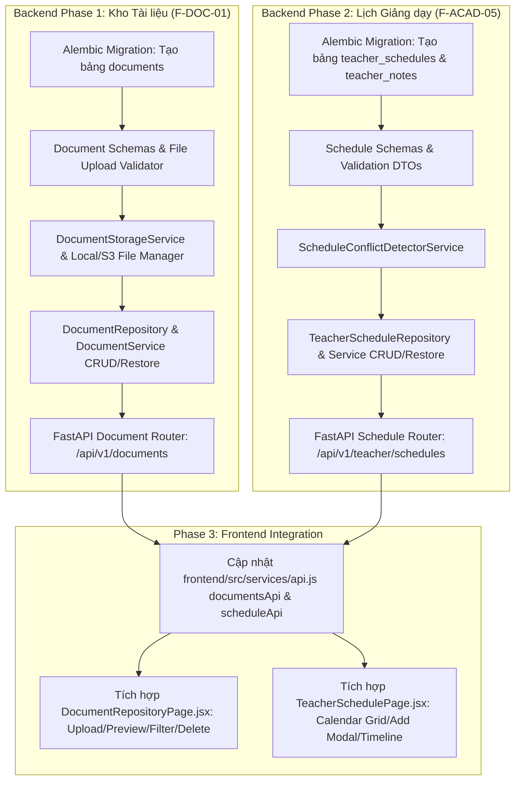

# Sprint 4 — Kho Học liệu & Lịch Giảng dạy Giáo viên (Document Repository & Teacher Schedule)

> Path: `docs/v_1/sprints/sprint_4_overview.md` · Module(s): `document`, `academic`, `teacher`  
> Created At: `2026-09-23`  
> Created By: `Tam Khang`  
> Updated At: `2026-09-23`  
> Updated By: `Tam Khang`  

---

## 1. Mục tiêu Sprint (Sprint Objectives)

Triển khai nhóm tính năng **Ưu tiên 2 (Priority 2)** nhằm số hóa toàn diện học liệu số và công tác lập kế hoạch giảng dạy của Giáo viên, thay thế toàn bộ Mock Data tại 2 màn hình quan trọng trên Frontend:

1. **Kho Tài liệu & Học liệu Số (Document Repository - `F-DOC-01`)**: Xây dựng phân hệ upload, lưu trữ, quản lý metadata, phân loại theo môn học / khối lớp, xem trước (preview), tải xuống an toàn và xóa mềm/khôi phục tài liệu giảng dạy.
2. **Thời khóa biểu & Lịch Giảng dạy Giáo viên (Teacher Schedule & Timetable - `F-ACAD-05`)**: Xây dựng hệ thống quản lý lịch dạy, ca dạy, phòng học, phát hiện trùng lịch (conflict detection), phân loại mức độ khẩn cấp (Urgency Tagging) và danh sách ghi chú công việc sư phạm theo ngày.
3. **Tích hợp Frontend**: Kết nối trực tiếp [frontend/src/services/api.js](file:///e:/tk_teacher_assistance_system/frontend/src/services/api.js) với [DocumentRepositoryPage.jsx](file:///e:/tk_teacher_assistance_system/frontend/src/pages/teacher/DocumentRepositoryPage.jsx) và [TeacherSchedulePage.jsx](file:///e:/tk_teacher_assistance_system/frontend/src/pages/teacher/TeacherSchedulePage.jsx).

---

## 2. Thông tin Tổng quan (Sprint Metadata)

| Thuộc tính | Giá trị |
|:---|:---|
| **Sprint ID** | `SPRINT-04` |
| **Trạng thái** | `planning` |
| **Công nghệ Backend** | FastAPI · SQLAlchemy 2.0 · PostgreSQL · Alembic · Pydantic v2 · Python-Multipart · Local/S3 Storage Adapter |
| **Công nghệ Frontend** | React 18 · Axios Client · Lucide React · CSS Grid Calendar System |
| **Phụ thuộc** | `F-AUTH-01` (Auth/RBAC Core), `F-ACAD-01..04` (Môn học, lớp học, phân công giảng dạy) |
| **Bảng CSDL liên quan** | `documents`, `teacher_schedules`, `teacher_notes`, `subjects`, `classes`, `users` |

---

## 3. Quyết định Thiết kế & Giả định Nghiệp vụ (Assumptions & Decisions)

| # | Quyết định | Lý do & Căn cứ kỹ thuật |
|:---|:---|:---|
| **AS-01** | **Chính sách Xóa mềm 100% (Soft Delete Policy)**: Tất cả tài liệu học liệu và lịch giảng dạy khi xóa chỉ chuyển `status` sang `DELETED`. Cung cấp endpoint `RESTORE` để khôi phục dữ liệu tức thì. | Tuân thủ Quy tắc 6 của hệ thống và bảo toàn dữ liệu học liệu qua các năm học. |
| **AS-02** | **Quản lý Lưu trữ File An toàn**: Hỗ trợ định dạng file: `.pdf`, `.docx`, `.doc`, `.pptx`, `.ppt`, `.xlsx`, dung lượng tối đa 50MB/file. File được lưu theo cấu trúc thư mục hashed trên đĩa cứng (`uploads/documents/YYYY/MM/UUID.ext`), che giấu đường dẫn thực trên server. | Đảm bảo tính bảo mật của tài nguyên giáo dục và tránh xung đột tên file. |
| **AS-03** | **Phân quyền Phạm vi Tài liệu (Document RBAC Scoping)**: Giáo viên có thể tải lên tài liệu cá nhân (chỉ GV đó thấy) hoặc tài liệu công khai toàn trường/tổ bộ môn (`is_public = true`). Giáo viên chỉ có quyền chỉnh sửa/xóa tài liệu do chính mình tải lên. Admin có toàn quyền quản trị. | Đảm bảo quyền tác giả của giáo viên và tăng tính chia sẻ trong tổ chuyên môn. |
| **AS-04** | **Phát hiện Trùng lịch (Conflict Detection)**: Khi giáo viên thêm hoặc sửa lịch dạy, Backend tự động kiểm tra xem khung giờ (`start_time` - `end_time`) trong cùng một ngày có bị trùng với tiết dạy khác của cùng giáo viên hoặc cùng phòng học hay không. | Ngăn chặn việc xếp trùng ca dạy gây gián đoạn công tác giảng dạy thực tế. |
| **AS-05** | **Phân loại Mức độ Khẩn cấp (Urgency Tagging Dictionary)**: Lịch dạy hỗ trợ 5 nhóm phân loại chuẩn hóa khớp với Frontend: `critical` (Khẩn cấp / Kiểm tra), `high` (Ưu tiên cao), `teaching` (Lịch giảng dạy tiêu chuẩn), `ai` (Luyện tập AI), `meeting` (Họp khoa / Sự kiện). | Đồng bộ dữ liệu hiển thị màu sắc trên lưới thời khóa biểu của Frontend. |

---

## 4. Danh mục Features trong Sprint (Features List)

| Feature ID | Tên tính năng | Module | Tài liệu Spec / File nguồn | Trạng thái |
|:---|:---|:---|:---|:---:|
| `F-DOC-01` | **Teacher Document Repository** (Kho Học liệu & Quản lý Tài liệu) | `document` / `teacher` | [f_doc_01_document_repository_spec.md](../specs/f_doc_01_document_repository_spec.md) | `planning` |
| `F-ACAD-05` | **Teacher Schedule & Timetable** (Thời khóa biểu & Lịch Giảng dạy) | `academic` / `teacher` | [f_acad_05_teacher_schedule_spec.md](../specs/f_acad_05_teacher_schedule_spec.md) | `planning` |

---

## 5. Chi tiết API Endpoints cần xây dựng

### 5.1. Phân hệ Kho Học liệu (`/api/v1/documents`)

```text
POST   /api/v1/documents/upload                Tải lên tài liệu mới kèm metadata (multipart/form-data)
GET    /api/v1/documents                       Danh sách tài liệu (Filter: subject_id, grade, type, search, pagination)
GET    /api/v1/documents/{id}                  Lấy thông tin chi tiết tài liệu
PUT    /api/v1/documents/{id}                  Cập nhật metadata tài liệu (tiêu đề, mô tả, môn học, khối lớp, tags)
DELETE /api/v1/documents/{id}                  Xóa mềm tài liệu (status = 'DELETED')
POST   /api/v1/documents/{id}/restore          Khôi phục tài liệu đã xóa mềm
GET    /api/v1/documents/{id}/download         Tải file tài liệu về máy (hỗ trợ Resume Download & Content-Disposition)
GET    /api/v1/documents/{id}/preview-url      Lấy URL xem trước tài liệu trực tuyến (PDF Stream / Image View)
```

### 5.2. Phân hệ Lịch Giảng dạy & Thời khóa biểu (`/api/v1/teacher/schedules`)

```text
GET    /api/v1/teacher/schedules               Lấy danh sách lịch dạy (Filter: month, year, week, grade, urgency)
POST   /api/v1/teacher/schedules               Tạo mới một tiết dạy / lịch kiểm tra (có validate trùng lịch)
GET    /api/v1/teacher/schedules/{id}          Xem chi tiết một ca dạy
PUT    /api/v1/teacher/schedules/{id}          Cập nhật thông tin ca dạy (thời gian, phòng học, tính chất)
DELETE /api/v1/teacher/schedules/{id}          Xóa mềm ca dạy (status = 'DELETED')
POST   /api/v1/teacher/schedules/{id}/restore  Khôi phục ca dạy đã xóa
GET    /api/v1/teacher/schedules/day/{date}    Lấy danh sách tiết dạy và timeline chi tiết trong ngày chỉ định

GET    /api/v1/teacher/notes                   Lấy danh sách ghi chú công việc theo ngày/tháng
POST   /api/v1/teacher/notes                   Thêm ghi chú công việc mới
PUT    /api/v1/teacher/notes/{id}              Cập nhật ghi chú (nội dung, trạng thái hoàn thành is_completed)
DELETE /api/v1/teacher/notes/{id}              Xóa ghi chú công việc
```

---

## 6. Sơ đồ Luồng Thực thi (Execution & Dependency Graph)



---

## 7. Tiêu chuẩn Hoàn thành (Definition of Done — Sprint 4)

| ✓ | Tiêu chí Kiểm thử & Nghiệp vụ | Trạng thái |
|:---:|:---|:---:|
| ☐ | **Alembic Migrations**: Sinh và áp dụng migration tạo bảng `documents`, `teacher_schedules`, `teacher_notes` với cột `status` (`ACTIVE`, `INACTIVE`, `DELETED`). | `pending` |
| ☐ | **Document Upload & Storage**: Upload file thành công, kiểm soát đúng định dạng (.pdf, .docx, .pptx) và dung lượng, lưu file an toàn trên server. | `pending` |
| ☐ | **Document CRUD & Soft Delete**: Lọc tài liệu theo môn học, khối lớp, phân trang mượt mà; xóa mềm và khôi phục hoạt động 100%. | `pending` |
| ☐ | **Schedule Conflict Check**: API bắt lỗi và trả về mã lỗi `ERR-SCHED-TIME_CONFLICT` khi trùng ca dạy hoặc trùng phòng học. | `pending` |
| ☐ | **Teacher Notes CRUD**: Tạo, sửa, tick chọn hoàn thành và xóa ghi chú công việc gắn với ngày học thành công. | `pending` |
| ☐ | **Tích hợp Frontend**: Kết nối hoàn chỉnh [DocumentRepositoryPage.jsx](file:///e:/tk_teacher_assistance_system/frontend/src/pages/teacher/DocumentRepositoryPage.jsx) và [TeacherSchedulePage.jsx](file:///e:/tk_teacher_assistance_system/frontend/src/pages/teacher/TeacherSchedulePage.jsx) với Backend API, loại bỏ toàn bộ mock state. | `pending` |
| ☐ | **Kiểm thử Tự động (Pytest)**: Viết và chạy thành công 100% bộ unit/integration tests cho module `document` và `schedule`. | `pending` |
| ☐ | **Chuẩn Code & Header**: Tuân thủ Quy tắc Coding Standards (100% comments bằng tiếng Anh, tác giả `Tam Khang`). | `pending` |

---

## 8. Danh mục Catalogs, Permissions & Error Codes khởi tạo

### 8.1. Danh mục Quyền hạn Mới (Permissions)
* `DOC_DOCUMENT_MANAGE`: Quyền tải lên, chỉnh sửa, xóa và khôi phục tài liệu học liệu.
* `DOC_DOCUMENT_VIEW`: Quyền xem danh sách, xem trước và tải về tài liệu học liệu.
* `SCHED_TEACHER_MANAGE`: Quyền tạo mới, chỉnh sửa, xóa lịch dạy và ghi chú công việc của giáo viên.
* `SCHED_TEACHER_VIEW`: Quyền xem lịch giảng dạy và thời khóa biểu của giáo viên.

### 8.2. Danh mục Mã Lỗi Mới (Error Codes)
* `ERR-DOC-FILE_TYPE_UNSUPPORTED`: Định dạng file tải lên không nằm trong danh mục hỗ trợ.
* `ERR-DOC-FILE_SIZE_EXCEEDED`: Dung lượng file vượt quá giới hạn 50MB.
* `ERR-DOC-DOCUMENT_NOT_FOUND`: Tài liệu không tồn tại hoặc đã bị xóa.
* `ERR-DOC-ACCESS_DENIED`: Không có quyền thao tác trên tài liệu riêng tư của giáo viên khác.
* `ERR-SCHED-SCHEDULE_NOT_FOUND`: Ca dạy không tồn tại trong hệ thống.
* `ERR-SCHED-TIME_CONFLICT`: Khung giờ giảng dạy bị trùng với một ca dạy khác đã tồn tại.
* `ERR-SCHED-ROOM_OCCUPIED`: Phòng học đã được xếp cho một lớp học khác trong cùng khung giờ.
* `ERR-SCHED-INVALID_TIME_RANGE`: Thời gian kết thúc phải diễn ra sau thời gian bắt đầu.
